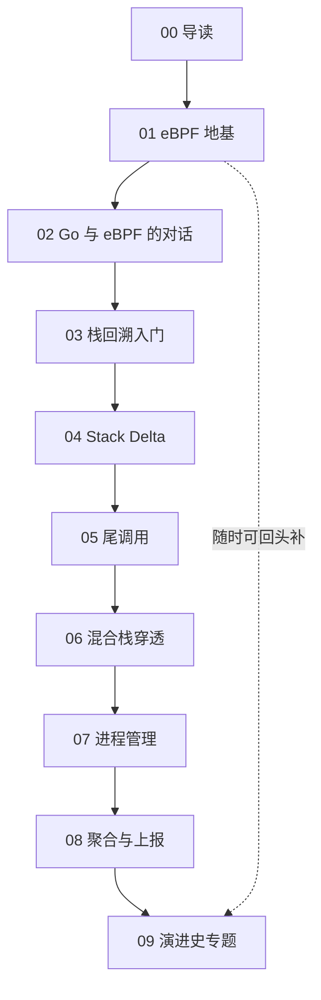

# 00 导读：从提交历史看项目的诞生与演进

> 本系列教程基于真实开源仓库 [opentelemetry-ebpf-profiler](https://github.com/open-telemetry/opentelemetry-ebpf-profiler) 撰写。文中所有源码引用均为仓库内相对路径 + 行号（如 `support/ebpf/types.h:687`），你可以随时打开对应文件对照阅读。

## 本篇目标

在开始逐行啃代码之前，我们先站上高处看清三件事：

1. **这个项目是做什么的**——它解决了什么问题，为什么难；
2. **它是怎么来的**——用 `git log` 复盘它的诞生与演进，理解"为什么核心代码是一次性出现的"；
3. **这套教程怎么带你走完全程**——10 篇内容的路线图、依赖关系，以及你需要准备的知识与环境。

读完本篇，你不需要记住任何细节，但应该对"我们将要攀登的这座山"有一张全景地图。此外，本篇的动手实验会教你一项贯穿全系列的元技能：用 git 命令亲自验证任何关于项目历史的说法——而不是轻信任何二手叙述。

## 前置知识（名词解释集中区）

本篇会反复出现以下名词，先在这里一次性讲清楚，后文首次出现时也会有简短提示。

> **名词解释：profiling（性能剖析）**
> 一种"给程序做体检"的技术：在程序运行时，周期性地记录"此刻 CPU 正在执行哪个函数、是被谁调用的"，最后统计出时间都花在了哪里。**持续 profiling（continuous profiling）** 则是 7×24 小时不间断地做这件事，用很低的开销换取全生产环境的性能可观测性。类比：给工厂流水线每隔几秒拍一张照片，事后统计哪台机器最忙。

> **名词解释：栈回溯（stack unwinding / stack trace）**
> 函数调用会在线程的"调用栈"上留下一串串"帧"（frame），每个帧记录"我在哪个函数、返回后回到哪里"。栈回溯就是顺着这些线索，从当前执行点一路倒推出完整的调用链（`main → foo → bar → ...`）。这是 profiling 的核心动作——采样只是"按下快门"，回溯才是"读出照片内容"。

> **名词解释：eBPF（extended Berkeley Packet Filter）**
> Linux 内核内置的一个安全沙箱虚拟机。你可以把用受限 C 方言编写的小程序加载进内核，挂到各种事件上（定时器、系统调用、函数入口……），内核的 **verifier（验证器）** 会静态检查它绝不会死循环、绝不会越界访问，然后 JIT 编译成原生机器码执行。类比：在内核里开了一家"只能按规定菜谱做菜"的中央厨房——足够快，也绝对安全。本项目内核态部分的全部代码就在 `support/ebpf/` 目录下（可以看到 `hotspot_tracer.ebpf.c`、`python_tracer.ebpf.c`、`native_stack_trace.ebpf.c` 等一大票 `.ebpf.c` 文件）。

> **名词解释：OTel / OTLP（OpenTelemetry / OpenTelemetry Protocol）**
> OpenTelemetry（简称 OTel）是 CNCF 旗下的可观测性标准，统一了 traces（调用链）、metrics（指标）、logs（日志）以及正在标准化中的 **profiles（性能剖析）** 四种信号。OTLP 是它定义的传输协议（基于 gRPC/HTTP）。**collector（收集器）** 是 OTel 体系中的数据中转站：接收各种来源的数据，处理后转发到后端。本项目的最终产物，就是把剖析数据以 OTLP Profiles 信号推送给 collector/后端。

> **名词解释：map / ring buffer / perf event / 尾调用 / verifier 等**
> 这些是 eBPF 的专属术语（map 是内核与用户态共享的键值存储，ring buffer / perf event 是内核向用户态推事件的通道，尾调用是 eBPF 程序之间"接力"跳转的手段，verifier 是上面提到的内核静态检查器）。本篇只需有印象，第 01、02、05 篇会逐一展开。

> **名词解释：on-CPU 与 off-CPU profiling（采样对象）**
> 经典的采样 profiler 回答"CPU 时间花在哪"（on-CPU）：定时器每隔一小段时间打断一个线程，记下它在执行什么。off-CPU profiling 回答另一个问题——"线程把时间等在了哪"（锁、IO、网络）。本项目的 on-CPU 采样是主线（第 01–06 篇）；off-CPU 能力经历了一次从 tracer 迁入统一 probes 框架的架构重构（2026-08，提交 `2de7551`），将在第 09 篇作为演进案例剖析。

> **名词解释：LPM / CFA / JIT / .eh_frame（后面会频繁出现，先混个脸熟）**
> LPM（Longest Prefix Match，最长前缀匹配）是 eBPF map 的一种类型，用来按"地址落在哪个区间"查找条目——本项目用它判断"当前指令指针属于哪个可执行文件的哪段内存"。CFA（Canonical Frame Address，规范帧地址）是 DWARF 调试信息里的概念，指"调用方帧的基准地址"，stack delta 的计算围绕它展开（第 04 篇主角）。JIT（Just-In-Time，即时编译）指 JVM/V8 等运行时在运行中把字节码编译成机器码，其帧没有静态元数据可查，所以最难回溯（第 06 篇）。`.eh_frame` 是 ELF 可执行文件里一段原本为 C++ 异常准备的展开信息，被本项目"废物利用"为回溯依据。

## 这个项目是做什么的

用 README 开头一句话概括（`README.md:3-4`）：这是一个 **Linux 全系统、跨语言的持续 profiling agent，基于 eBPF 实现**。

拆开看，它的能力清单相当惊人（均来自 `README.md:6-30`）：

- **全系统**：不是插桩某一个进程，而是对整台机器上所有进程采样，CPU 开销上限约 1%、内存上限约 250MB；
- **零侵入**：不需要改代码、不需要加载 agent 库、不需要重启目标进程，甚至连目标语言的虚拟机（JVM、CPython 等）都用默认配置即可；
- **无帧指针也能回溯**：即使系统库编译时省略了帧指针（frame pointer）、且主机上没有任何调试符号，也能回溯——靠的是从可执行文件的 `.eh_frame` 段提前提取的"栈差分（stack delta）"信息（`README.md:11-15`，第 04 篇的绝对主角）；
- **混合栈穿透**：一条 trace 可以从内核态出发，穿过未修改的系统 libc，一路进入 JVM、Python、Ruby、PHP、Node.js/V8、Perl、Erlang、.NET 等高级语言的帧（`README.md:16-22`，第 06 篇的主题）；
- **amd64 与 arm64 全架构支持**。

它的内部结构，官方文档 `doc/internals.md` 讲得很清楚。整个 agent 分为两个世界：

```text
┌─────────────────────────── Linux 内核 ───────────────────────────┐
│  定时器/perf event 触发                                          │
│     └─> native_tracer_entry (support/ebpf/native_stack_trace.    │
│         ebpf.c:202)  读取寄存器，初始化回溯状态                   │
│           └─> 按当前 PC 所在语言，尾调用给对应语言的 unwinder      │
│                 └─> unwind_stop (support/ebpf/interpreter_       │
│                     dispatcher.ebpf.c:272) 收尾，交出完整 trace  │
└──────────────┬───────────────────────────────────────────────────┘
               │ map / perf event（第 02 篇）
┌──────────────▼─────────────────── 用户态 (Go) ───────────────────┐
│  tracer（加载/挂载 eBPF 程序，事件泵）                            │
│    ├─> process manager（进程发现、为 BPF 准备回溯"知识"）         │
│    ├─> trace handler（把内核格式 trace 转成用户态格式）           │
│    └─> reporter（聚合计数、转成 OTLP、gRPC 推给后端 collector）   │
└──────────────────────────────────────────────────────────────────┘
```

两个世界之间流通的核心货物是"栈回溯"。`doc/internals.md:34-42` 把回溯的本质概括成一段伪代码——每个支持任意嵌套函数调用的语言，都必须自己记住"当前函数返回后回到哪里"，而 unwinder 恰恰借用这份信息反推整条调用链。内核侧产出的原始 trace 是 `support/ebpf/types.h:687` 的 `struct Trace`（pid、tid、内核时间戳加上一串帧数据）；用户侧加工后的最终形态是 `libpf/trace.go:130` 的 Go 版 `Trace` 结构体（帧列表 + 缓存的哈希）。第 03、08 篇会带你看清这两种形态如何衔接。

### 这件事为什么难

也许你会想：不就是定时读一下调用栈吗？难点恰恰在于这个项目给自己立的几条"军规"：

1. **要快**：1% CPU 的开销上限意味着每次采样只能用微秒级预算。所以回溯必须在内核里完成——如果把原始内存搬到用户态慢慢算，开销会爆炸。
2. **要稳**：eBPF verifier 对内核态程序有苛刻限制（指令数上限、禁止无界循环等，`doc/internals.md:204-225` 有专门一节），"完整回溯一条 128 帧的栈"和"单个 eBPF 程序算不完"之间的矛盾，逼出了第 05 篇要讲的尾调用接力架构。
3. **要通吃**：C/C++、Go、Rust 用 `.eh_frame` 或 `.gopclntab`（`doc/internals.md:181-193`），JVM、Python 等各有自己的运行时布局。一种回溯策略不可能通吃，于是有了"dispatcher + 每种语言一个 unwinder"的多语言架构（第 06 篇）。
4. **要零依赖**：生产环境的二进制通常是 strip 过的（没有符号），所以 native 帧的符号化被挪到了后端做，agent 只发送"文件 ID + 偏移"（`doc/internals.md:57-75`）。这也是为什么会有 `host/host.go:15` 那种为了节省内核内存而截断到 64 位的 FileID。

记住这四条军规——后面九篇里几乎每一个"奇怪"的设计决策，都能追溯到其中某一条。

## 提交历史分析：这个项目是怎么来的

下面每一条结论都是用 `git` 命令在仓库里亲自核实过的，建议你跟着敲一遍——读一个项目的提交历史，就像读它的传记。

### 起点：一个"含着全部家当出生"的项目

```bash
git log --oneline --reverse | head -5
git show --stat ff5b644 | tail -3
git log -1 --format='%B' ff5b644
```

输出告诉我们：

```text
ff5b644 Initial commit          # 2024-04-15
...
 445 files changed, 67602 insertions(+)
```

第一个提交 `ff5b644`（2024 年 4 月 15 日）就一次性导入了 **445 个文件、67602 行代码**——eBPF 回溯器、Go 用户态、几乎所有语言的 unwinder，全部已经在了。提交信息里有一句关键的话：

> Pre-OSS Optimyze/Elastic contributors can be found in AUTHORS.md.

也就是说：这不是一个从零慢慢长大的项目，而是 **Optimyze（一家做持续 profiling 的创业公司，后被 Elastic 收购）内部多年研发成果的企业捐赠**，由 Elastic 开源给 OpenTelemetry 社区。证据链还有一条：2024-06-21 的提交 `3c6d811`，标题干脆就叫 "Synchronize with Elastic's private repo (#38)"——公开仓库一度还在和 Elastic 私有仓库做同步，而这次同步带来了 dotnet unwinder 全家桶（`interpreter/dotnet/` 十几个新文件、`support/ebpf/dotnet_tracer.ebpf.c`）以及 `nativeunwind/elfunwindinfo/stackdeltaprovider.go`、`remotememory` 等重要组件。

这个出身直接决定了本系列的讲法：**按提交时间顺序讲是行不通的**——核心架构在第一个提交里就已经完整，没有"演进过程"可看。因此我们的教学顺序是 **"按架构分层重建"**：假装这个项目不存在，带着你从"第一个能跑起来的采样程序"开始，一层一层把它重新盖出来。提交历史则被单独放到第 00 篇（本篇）和第 09 篇，用来回答另一类问题："新能力是怎么长出来的"。

### 里程碑：捐赠之后，社区如何让它继续生长

```bash
# 逐个核实（任选）：
git log -1 --format='%h %ad %s' --date=short 3c6d811 9c4b3f2 a243f85 fa0cef5 77e078d
git log --format='%h %ad %s' --date=short --all | grep -iE 'luajit|dotnet9|dotnet10|usdt'
```

| 日期 | 提交 | 里程碑 | 说明 |
|---|---|---|---|
| 2024-04-15 | `ff5b644` | 整体导入 | 445 文件 / 67602 行，Elastic 捐赠开源 |
| 2024-06-21 | `3c6d811` | dotnet unwinder | 与 Elastic 私有仓库同步，加入 .NET 回溯、stack delta provider、remotememory |
| 2025-01-09 | `9c4b3f2` | collector receiver | "Setup collector receiver (#160)"，agent 正式以 OTel Collector receiver 形态集成 |
| 2025-06-13 | `a243f85` | kallsyms 模块 | 重构内核符号化，新增高效的内核符号存储与按模块重载 |
| 2025-08-21 | `fa0cef5` | uprobes 支持 | 新增 `support/ebpf/uprobe.ebpf.c`，可挂钩用户态函数入口 |
| 2025-11-18 | `77e078d` | BEAM 支持起步 | Erlang/Elixir 虚拟机的 no-op plumbing（`interpreter/beam/beam.go`） |
| 2026-01 | `ab2320f` / `cbec671` | dotnet 9 / 10 | 跟进 .NET 新版本的运行时结构布局 |
| 2026-07-16 | `f9f4a29` | LuaJIT 起步 | LuaJIT 解释器的桩代码与脚手架 |
| 2026-08 | `bad4ab1` 等 | probes 框架 + off-CPU 迁移 + 内存 profiling 设计 | `bad4ab1` 引入统一 Probes API；`ddab417` 内存 profiling RFC 设计文档；`2de7551` 把 off-CPU profiling 从 tracer 迁入 probes |
| 2026-09-04 | `5446fa6` | USDT | "memory profiling 2/4: USDT discovery and parsing"，解析用户态静态定义追踪点 |

这张表值得多读两遍，它揭示了工业级开源项目的三种典型生长模式：

1. **横向铺语言**：dotnet → BEAM → LuaJIT，每加一种语言都是"先 no-op 脚手架、再逐步填充"（`77e078d`、`f9f4a29` 的提交信息里都有 "no-op plumbing"/"Stubs and boilerplate" 字样）；
2. **纵向跟版本**：被 profiling 的目标语言自己在演进，dotnet 9/10 的支持就是跟着上游运行时结构变化走的；
3. **架构级重构**：collector receiver、probes 框架、kallsyms、off-CPU 迁移这类提交，是在不动功能的前提下重塑骨架——这正是第 09 篇要细讲的"演进史"。

### 这个出身对我们的学习意味着什么

"企业捐赠、整体导入"的项目和"从零起步、社区共建"的项目，读起来是完全不同的两种书：

- 后者的历史是**教案**——从 hello world 到完整功能，每一步演进都顺理成章，顺着提交历史读就是最佳学习路径；
- 前者的历史是**传记**——第一章主角就已经功成名就，你要做的不是"陪它长大"，而是"解剖它的现在、回溯它的过去"。

所以本系列的策略是：**主体（01–08 篇）按架构分层，把这个项目"重新发明"一遍；历史（本篇 + 09 篇）单独成线，用来理解设计决策的来龙去脉。** 两条线在 09 篇汇合——到那时你已经懂了架构，再看演进史，每个提交为什么那样改，都会豁然开朗。

### 源码导航：一张目录地图

动手之前，先把仓库的"地理"摸清（以下目录均在仓库根目录下）：

| 目录 | 角色 | 对应篇目 |
|---|---|---|
| `support/ebpf/` | 内核态 eBPF C 代码：各语言 unwinder、dispatcher、公共类型 | 01、03–06 |
| `support/` | eBPF 与 Go 之间的类型契约（两侧共享的常量与结构） | 02 |
| `tracer/` | 用户态核心：加载挂载 eBPF、事件泵 | 02 |
| `processmanager/` | 进程管理：维护进程映射、下发回溯知识、路由符号化 | 07 |
| `interpreter/` | 每种语言一个 handler（hotspot、python、dotnet、beam……） | 06 |
| `nativeunwind/` | 从 `.eh_frame` / `.gopclntab` 提取 stack delta | 04 |
| `reporter/` | 聚合、去重、OTLP/gRPC 上报 | 08 |
| `libpf/` | 用户态基础类型（Trace、FileID、哈希等） | 贯穿 |
| `host/` | 与 eBPF map 交互的类型（如 64 位截断 FileID） | 02、08 |
| `collector/` | OTel Collector receiver 集成（2025-01 加入） | 08 |
| `doc/` | 官方内部设计文档，`internals.md` 是本站 | 00 |
| `design-docs/` | RFC 设计文档（如内存 profiling 提案） | 09 |
| `tools/coredump/` | 把 BPF 回溯器编译成用户态程序、用 coredump 做回归测试 | 09 |

读代码时如果迷路了，就回到这张表问自己："我现在在读的这段代码，属于哪个世界、哪个组件？"

## 全系列路线图：10 篇怎么走

系列采用"按架构分层重建"的顺序，每一篇都建立在前面篇目的地基之上：

```text
00 导读（本篇）：地图与传记
        │
        ▼
01 eBPF 地基 ────────── 第一个能跑的采样程序：perf event 触发、map 通信
        │
        ▼
02 Go 与 eBPF 的对话 ── 用户态如何加载/配置 eBPF、事件通道如何收发
        │
        ▼
03 栈回溯入门 ───────── 帧指针链式回溯，最简单的调用栈还原
        │
        ▼
04 Stack Delta ──────── 没有帧指针时，用 .eh_frame 预计算的"差分"回溯
        │
        ▼
05 尾调用 ───────────── 单个 eBPF 程序受指令数限制，用尾调用接力拼出大回溯器
        │
        ▼
06 混合栈穿透 ───────── 一条 trace 穿越内核、libc、JVM：dispatcher 与解释器 unwinder
        │
        ▼
07 进程管理 ─────────── 内核发现新进程 → 用户态解析 → 向 BPF map 下发回溯知识
        │
        ▼
08 聚合与上报 ───────── trace 去重、计数聚合、OTLP gRPC 推送到 collector
        │
        ▼
09 演进史专题 ───────── 回到提交历史，看 dotnet/BEAM/uprobes/内存 profiling 如何落地
```

每篇一句话：

- **00 导读**：看清项目全貌、来历与学习方法（本篇）。
- **01 eBPF 地基**：动手写出并跑通一个最简采样 eBPF 程序，理解它"为什么必须长这样"。
- **02 Go 与 eBPF 的对话**：搞懂用户态 Go 程序与内核 eBPF 程序之间的加载、配置与事件收发全链路。
- **03 栈回溯入门**：用帧指针完成一次完整的调用栈还原，理解 unwinder 的本质。
- **04 Stack Delta**：面对现实世界（省略帧指针的 -fomit-frame-pointer 二进制），学会用预计算的栈差分回溯。
- **05 尾调用**：认识 verifier 的指令数天花板，看项目如何用尾调用把回溯器拆成一支"接力队"。
- **06 混合栈穿透**：跟随一条 trace 从内核态一路穿过 libc 进入 JVM 字节码帧，理解多语言调度。
- **07 进程管理**：看内核如何上报进程生灭，用户态如何把"回溯知识"塞进 BPF map 供内核查阅。
- **08 聚合与上报**：从原始采样到哈希去重、计数聚合，最终以 OTLP Profiles 信号推给后端。
- **09 演进史专题**：以真实提交为线索，复盘一个新语言能力从 RFC 到合入的完整生命周期。

**依赖关系**（阅读建议）：



主线是严格递进的：01–02 打 eBPF 与通信的地基，03–05 攻克"回溯"这座主峰，06–08 把单点能力织成完整系统，09 收束全局。如果你已有 eBPF 基础，可以跳过 01–02；如果只对某个语言运行时感兴趣（如 JVM），也请先读完 03–06 再挑读。

## 动手实验：读历史，也验历史

本篇的"实验"不需要写代码，而是训练一项贯穿全系列的基本功：**用 git 亲自验证任何关于项目历史的说法**。

1. 克隆仓库（如果你还没有本地副本）：
   ```bash
   git clone https://github.com/open-telemetry/opentelemetry-ebpf-profiler.git
   cd opentelemetry-ebpf-profiler
   ```
2. 验证"整体导入"：
   ```bash
   git show --stat ff5b644 | tail -3        # 应看到 445 files changed, 67602 insertions(+)
   git log -1 --format='%B' ff5b644         # 读完整的初始提交信息
   ```
3. 抽查两个里程碑，确认提交信息和涉及文件：
   ```bash
   git show --stat 3c6d811 | head -30       # dotnet unwinder 的到来
   git show --stat 77e078d | head -30       # BEAM 的 no-op 起步
   git show --stat fa0cef5 | head -20       # uprobes 支持
   ```
4. 进阶挑战：用 `git log --format='%h %ad %s' --date=short -- support/ebpf/` 单独查看内核态代码的演进，和 Go 用户态（`git log --oneline -- processmanager/ reporter/`）对比一下，想想两个世界的更新节奏有何不同、为什么。
5. 观察"新语言如何起步"的完整过程，以 BEAM 为例：
   ```bash
   git log --oneline --reverse -- interpreter/beam/ support/ebpf/beam_tracer.ebpf.c | head -20
   ```
   你应该会看到从 no-op 脚手架到逐步填充真实回溯逻辑的一串提交。第 09 篇我们会用同样方法解剖 LuaJIT。

做完这几步，你已经掌握了本系列最重要的"元技能"：本教程中的每一个历史论断，你都有能力自己动手验证或推翻。读源码如此，读历史亦如此——不要轻信任何二手叙述，包括本教程。

## 读者准备：知识与环境

**知识要求**（本系列的假设起点）：

- 会基本的 Go 和 C 语法（能读懂结构体、指针、循环即可，不需要精通）；
- 用过 Linux 命令行，知道什么是进程、线程、系统调用；
- **不需要**任何 eBPF 经验——这正是本系列存在的意义。

**环境要求**（从第 01 篇动手实验开始需要）：

- 一台 Linux 机器或虚拟机（macOS/Windows 用户请准备 Linux VM，见 `README.md:67-68`）；内核版本建议 5.10 及以上（amd64 与 arm64 的最低支持版本，见 `doc/internals.md:209`）；
- Go 工具链（构建用户态 agent）；
- clang + llvm（编译 eBPF C 代码）；项目支持用 Docker 做容器化构建，`make agent` 一条命令即可（`README.md:52-65`）；
- root 权限（加载 eBPF 程序、跑集成测试需要）。

**阅读本系列的三个建议**：

1. **打开仓库跟着点。** 文中每个 `路径:行号` 引用都是真实可点的；遇到不理解的段落，先去读上下文十行真实代码，再回来读解释，效果远好于空想。
2. **动手实验不要跳。** 每篇末尾的实验都设计为 15–30 分钟可完成，它们是把"看懂了"变成"会用了"的唯一桥梁。
3. **允许自己第一遍读不懂。** eBPF 项目的理解曲线是螺旋上升的：第 06 篇你会重新理解第 02 篇的事件通道，第 08 篇你会重新理解第 01 篇的 map。读不懂的地方标记下来继续前进，回头看时往往豁然开朗。

**行文约定**：正文中首次出现的专业名词都会配「名词解释」引用块；内核态代码称"BPF 代码"（社区习惯用法，与 eBPF 同义），用户态代码称"Go 代码"或"用户态"；引用的代码片段均保持在 20 行以内并逐块讲解。

## 小结

- OpenTelemetry eBPF Profiler 是一个 **Linux 全系统、跨语言、零侵入** 的持续 profiling agent：内核态 eBPF 负责栈回溯，用户态 Go 负责符号化与 OTLP 上报。它的设计被四条军规塑造：要快（内核内回溯）、要稳（verifier 限制）、要通吃（多语言 dispatcher 架构）、要零依赖（符号化后置到后端）。
- 它的核心代码源自 Elastic（前 Optimyze）的 **企业捐赠**，445 文件、67602 行一次性导入（`ff5b644`，2024-04-15），因此"按提交时间学"走不通，本系列改用 **"按架构分层重建"** 的路线。
- 捐赠之后的两年里，社区以"横向铺语言（dotnet/BEAM/LuaJIT）、纵向跟版本（dotnet 9/10）、架构级重构（collector receiver、probes 框架、kallsyms、off-CPU 迁移、内存 profiling 设计、USDT）"三种模式让它持续进化——所有里程碑提交我们都已用 git 命令逐一核实。
- 你已经拿到了全景地图：01–02 打地基，03–05 攻回溯，06–08 织系统，09 看演进；以及一张源码目录导航表，迷路时随时回来查。

## 下一篇预告

**01 eBPF 地基：第一个采样程序是如何跑起来的。**

我们将写出一个真正能在内核里运行的最简 eBPF 采样程序：用 perf event 定时触发，把采到的数据通过 map/ring buffer 送回用户态。你会第一次亲眼看到"内核里跑你写的代码"是怎么回事，也会第一次和 verifier 打交道——别紧张，它虽然严格，但报错信息会告诉你哪里不合规。

带上你的 Linux 机器，我们下一篇见。
