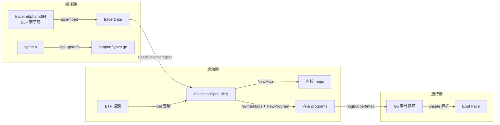

# 02 Go 与 eBPF 的对话：加载、配置与事件通道

> 本篇是《OpenTelemetry eBPF Profiler 源码教学系列》的第 2 篇。上一篇《eBPF 地基：第一个采样程序是如何跑起来的》我们已经让内核侧的程序跑了起来；本篇我们回到用户态，看 Go 代码如何把编译好的 eBPF 字节码「搬进」内核、注入配置、再架好一条条数据通道把采样结果运回来。

## 本篇目标

读完本篇，你应该能够：

- 说清楚 eBPF 字节码是如何通过 `go:embed` 进入 Go 二进制、再被解析成 `CollectionSpec` 的；
- 复述 `initializeMapsAndPrograms`（`tracer/tracer.go:444`）的完整加载流水线：先建 map、重写指令、再加载程序，以及**为什么**不用现成的一步到位的 API；
- 理解 `.rodata` 变量注入是怎么实现「启动期配置下发」的，BTF 在其中扮演什么角色；
- 区分三条从内核到用户态的数据通道：ring buffer、perf event array、以及批量读写的普通 map；
- 看懂 Go 与 C 之间共享结构体（如 `Trace`）是如何保证内存布局一致、并用 `unsafe.Pointer` 零拷贝解析的。

建议先读完第 01 篇。本篇会大量引用真实源码，请随时打开对应文件对照阅读。

## 前置知识（名词解释集中区）

> **名词解释：eBPF map**
> map 是内核与用户态共享的「字典 / 数组」，由内核托管，双方通过文件描述符（fd）访问。可以类比成一个跨进程共享内存的 Redis：内核态的 eBPF 程序用 `bpf_map_lookup_elem` 等辅助函数读写它，用户态的 Go 程序用 `Map.Lookup` / `Map.Update` 读写它。本项目的 map 有几十种：哈希表、数组、per-CPU 数组、程序数组（prog array）、ring buffer 等都是 map 的不同类型。

> **名词解释：BTF（BPF Type Format）与 CO-RE（Compile Once – Run Everywhere）**
> 内核结构体（比如描述一个进程的 `task_struct`）的布局**随内核版本而变**：同一个字段在 5.15 内核可能在偏移 2104 处，在 6.8 内核可能在 2168 处。如果 eBPF 程序编译时把偏移写死，换个内核就跑不了。BTF 是内核自带的「类型字典」（通常在 `/sys/kernel/btf/vmlinux`），记录了每个结构体每个字段的真实偏移；CO-RE 的思路就是「一次编译，靠 BTF 在加载时修正布局」。本项目走的是一条更朴素的路：在 Go 侧读 BTF、算出偏移，再把这些偏移当作配置数字写进 eBPF 的只读数据区——这是本篇的主线之一。

> **名词解释：ring buffer 与 perf event array**
> 两者都是「内核往用户态推数据」的通道。perf event array 是每个 CPU 一个独立的环形缓冲区，内核写入时可以立刻唤醒等待的用户态线程（事件驱动）；ring buffer（`BPF_MAP_TYPE_RINGBUF`）是所有 CPU 共享一个缓冲区，写入开销更低、顺序性更好，但本项目选择**定时轮询**它而不是被唤醒。可以类比：perf event array 像外卖骑手敲门（即时、但每颗 CPU 一个门），ring buffer 像楼下的快递柜（快递员投完就走，你定时下楼取）。

> **名词解释：unsafe.Pointer**
> Go 是内存安全的语言，不允许随便把一块字节当成结构体来读。`unsafe.Pointer` 是官方开的「后门」，可以跳过类型系统直接把 `[]byte` 强转成某个结构体指针。用对了（布局完全一致）就是零拷贝，用错了就是内存错乱。它是内核字节流与 Go 结构体之间的「转换插头」，本篇最后一节会看它如何被谨慎使用。

> **名词解释：ELF 与 CollectionSpec**
> eBPF 字节码也是以 ELF 文件格式打包的（和 Linux 可执行文件同一种容器），里面分门别类放着程序指令、map 定义、只读数据段。`CollectionSpec` 是 Go 库 cilium/ebpf 对这个 ELF 的**解析结果**——注意它只是「图纸」，此时还没有任何东西被加载进内核。

## 一、字节码从哪来：`go:embed` 把内核程序缝进 Go 二进制

先从最根本的问题开始：Go 进程启动时，eBPF 字节码在哪里？

答案是：编译期就被打包进了 Go 可执行文件。看 `support/support_amd64.go:12`：

```go
//go:embed ebpf/tracer.ebpf.amd64
var tracerData []byte
```

`//go:embed` 是 Go 1.16 引入的编译指令：把指定文件的内容原样塞进一个变量。于是 `tracer.ebpf.amd64`（clang 编译出的 eBPF ELF，仓库里可以直接看到它，见 `support/ebpf/tracer.ebpf.amd64`）就变成了 `tracerData` 这个 `[]byte`。分发时只有一个二进制，不用带额外的 `.o` 文件，部署体验极好。架构变体文件（`support_amd64.go`、`support_arm64.go`）靠构建标签（`//go:build amd64`）选择，各自嵌入对应的 ELF。

接下来是把这段字节解析成「图纸」，`support/support.go:15`：

```go
func LoadCollectionSpec() (*cebpf.CollectionSpec, error) {
	return cebpf.LoadCollectionSpecFromReader(bytes.NewReader(tracerData))
}
```

三行代码，信息量很大：

- `LoadCollectionSpecFromReader` 解析 ELF：把每个 eBPF 程序（函数）读成 `ProgramSpec`，把每个 map 定义读成 `MapSpec`，把 `.rodata` 段里的变量读成 `VariableSpec`，打包成 `CollectionSpec` 返回。
- 关键认知：**此时内核里什么都没有**。图纸只是图纸——程序还没通过 verifier（内核安全校验器）检查，map 还没有真实存在，程序里对 map 的引用还只是「占位符」。
- 这个函数刻意保持极简：所有复杂的初始化逻辑都留给调用方 `tracer` 包，方便单测和复用。

## 二、加载流水线总览：`initializeMapsAndPrograms`

真正的装载发生在 `tracer/tracer.go:444` 的 `initializeMapsAndPrograms`。我们先建立全景，再逐段拆解。它的流程是：

```
内核版本探测 (linux.GetCurrentKernelVersion)
      │
      ▼
LoadCollectionSpec()          ← 解析 ELF，得到图纸 CollectionSpec
      │
      ▼
按内核版本裁剪程序 (tracer.go:466)  ← 6.16+ 换 tracepoint 变体
      │
      ▼
loadRodataVars()              ← 注入配置（BTF 探测在这里发生）
      │
      ▼
syncVariablesToMapSpecs()     ← 把变量值同步回 map 初始数据
      │
      ▼
loadAllMaps()                 ← 逐个 NewMap，把 map 真正建进内核
      │
      ▼
rewriteMaps()                 ← 把程序里的 map 占位符改写成真实 fd
      │
      ▼
loadPerfUnwinders()           ← 加载 perf 事件入口程序 + 尾调用目标
      │
      ▼
loadProbeUnwinders()          ← 同一批程序的 kprobe 版本（改 map 引用再加载）
      │
      ▼
removeTemporaryMaps()         ← 销毁只在初始化期使用的 map
```

开头的几行先拿到内核版本，然后解析图纸（`tracer/tracer.go:456-471`）：

```go
major, minor, patch, err := linux.GetCurrentKernelVersion()
...
coll, err := support.LoadCollectionSpec()
...
if major > 6 || (major == 6 && minor >= 16) {
	// Tracepoint format for sched_process_free has changed in v6.16+.
	delete(coll.Programs, schedProcessFreeV1)
} else {
	delete(coll.Programs, schedProcessFreeV2)
}
```

注意 `delete(coll.Programs, ...)` 这一步：仓库里为 `sched_process_free` 这个 tracepoint 编译了两个版本的程序（6.16 内核改了它的参数格式），加载前按当前内核把不适用的那个从图纸里删掉。这是「图纸先改、再施工」的第一次体现。

## 三、为什么不用 `LoadAndAssign`：手工逐 map 加载的必要性

cilium/ebpf 提供了一条「高速公路」：`NewCollection` / `LoadAndAssign`，一句话把图纸里所有 map 和程序全部加载好，还能自动赋值到 Go 结构体字段上。那为什么本项目偏要走「乡间小路」——手工 `NewMap` 建 map、手工重写指令、手工 `NewProgram`？

`rewriteMaps` 的注释（`tracer/tracer.go:570-578`）直接给出了答案：

> This function used to be part of cilium/ebpf before it got deprecated and finally removed. **As we require to resize maps in loadAllMaps() we still need this functionality.**

具体有三个理由，我们逐一看代码。

### 理由 1：map 的大小要在加载时动态调整

`loadAllMaps`（`tracer/tracer.go:687`）在真正建 map 之前先改图纸。最典型的是 `trace_events` 这个 ring buffer（`tracer/tracer.go:714-719`）：

```go
onlineCPUs, err := onlineCPUsOnce()
if err != nil {
	return fmt.Errorf("failed to determine online CPUs: %v", err)
}
ringbufSize := uint64(cfg.SamplesPerSecond * len(onlineCPUs) * support.Sizeof_TraceWithData)
adaption["trace_events"] = uint32(min(util.NextPowerOfTwo(ringbufSize), 1<<31))
```

逻辑是：每秒采样数 × 在线 CPU 数 × 最坏情况下一条 trace 的字节数（`Sizeof_TraceWithData`），得到「1 秒突发数据量」，向上取 2 的幂作为缓冲区容量。回头再看 C 侧的 map 定义（`support/ebpf/interpreter_dispatcher.ebpf.c:127-130`）：

```c
struct trace_events_t {
  __uint(type, BPF_MAP_TYPE_RINGBUF);
  __uint(max_entries, 0);
} trace_events SEC(".maps");
```

C 侧故意把 `max_entries` 写成 0——真正的大小由 Go 在加载时按机器规模决定。同样的手法还用于 `pid_page_to_mapping_info`、stack delta 系列 map（按 `MapScaleFactor` 扩容）等。`LoadAndAssign` 走的就是图纸原样，插不进这个「改尺寸」的环节。

随后是逐个建 map（`tracer/tracer.go:764-768`）：

```go
ebpfMap, err := cebpf.NewMap(mapSpec)
if err != nil {
	return fmt.Errorf("failed to load %s: %v", mapName, err)
}
ebpfMaps[mapName] = ebpfMap
```

每个 map 单独 `NewMap` 调用 `bpf(BPF_MAP_CREATE)` 系统调用，建好后按名字存进 Go 的 `map[string]*cebpf.Map`——一个「map 的 map」，后文所有 `t.ebpfMaps["xxx"]` 都是从这里取。

### 理由 2：要先探测内核能力，再决定 map 的标志位

`loadAllMaps` 里有一句 `noPrealloc := probeNoPrealloc()`（`tracer/tracer.go:726`）。`probeNoPrealloc`（`tracer/tracer.go:652-684`）的做法非常有意思：**造一个玩具程序去试探内核**——它现场构造一个几行字节码的 eBPF 小程序，里面引用一个带 `BPF_F_NO_PREALLOC` 标志的哈希 map，然后尝试加载；加载成功说明当前内核允许 perf 事件程序用非预分配 map，于是 stack delta 系列 map 就会带上这个标志（省内存）。这就是「特性探测」（feature probing）：不问内核「你什么版本」，而是直接「试试看」。比版本号判断可靠得多，这是 eBPF 工程的通行做法，值得记住。

### 理由 3：同一批程序要以两种类型加载，且引用不同的 map

这是最硬核的理由。`loadProbeUnwinders`（`tracer/tracer.go:877-927`）把本来写给 perf 事件的回溯程序**动态改造成 kprobe 程序**（`tracer/tracer.go:911-917`）：

```go
// Repoint per_cpu_records to the probe unwinder's own record map.
recInsns := progArrayReferences(perCPURecordsFD, progSpec.Instructions)
for _, ins := range recInsns {
	if err := progSpec.Instructions[ins].AssociateMap(perCPURecordsKprobeMap); err != nil {
		return fmt.Errorf("failed to rewrite per_cpu_records ptr: %v", err)
	}
}
```

做法是扫描程序指令流，找出所有引用了 `per_cpu_records` map 的指令，把它们的引用**逐条改写**成另一个 map（`per_cpu_records_kp`）。注释解释了原因：uprobe 触发的回溯不能和 perf 采样共用同一块每 CPU 暂存区，否则一次 perf 采样会踩掉正在进行的 uprobe 回溯（`tracer/tracer.go:541-543`）。这种指令级手术，`LoadAndAssign` 完全不支持。

### rewriteMaps：把占位符换成真 fd

map 都建好之后，程序图纸里对 map 的引用还是编译期的「占位符」，必须换成内核返回的真实 fd。这就是 `rewriteMaps`（`tracer/tracer.go:581`）干的事：

```go
for symbol, m := range maps {
	seen := false
	for progName, progSpec := range coll.Programs {
		err := progSpec.Instructions.AssociateMap(symbol, m)
		...
	}
	...
	// Prevent NewCollection from creating rewritten maps
	delete(coll.Maps, symbol)
}
```

`AssociateMap` 扫描每个程序的指令，把引用了名为 `symbol` 的 map 的指令都绑定到已经建好的 `m`。末尾的 `delete(coll.Maps, symbol)` 很关键：把这个 map 从图纸里删掉，防止后续再走 `NewCollection` 时**重复创建**一个新的空 map——那会导致程序和用户态读写的是两份不同的数据。注释里还记录了一段历史：这个函数本来是 cilium/ebpf 的一部分，后来被废弃删除，项目因为依赖「先改尺寸再建 map」的流程而把它保留了下来（`tracer/tracer.go:574-578`）。

## 四、`.rodata.var`：启动期的配置注入

eBPF 程序不能读环境变量、不能读配置文件。那「每秒采样多少次」「要不要过滤错误帧」这类配置怎么传进去？

答案藏在 C 侧的一个宏里（`support/ebpf/bpfdefs.h:129-130`）：

```c
#define BPF_RODATA_VAR(_type, _name, _value)                                                     \
  _type _name __attribute__((section(".rodata.var"), used)) = _value;
```

它把一个带初值的全局变量放进 ELF 的 `.rodata.var` 段。rodata 即 read-only data（只读数据段）。加载时，这个段会被做进一个数组 map：eBPF 程序读这些变量，实际是从 map 里读，**编译后的指令里只记了变量在段里的偏移**。这意味着——只要在加载前改写段里对应偏移的字节，eBPF 程序读到的就是你改后的值，而且不用重新编译、不用 verifier 重新理解任何东西。

> **名词解释：启动期配置注入**
> 这就是 `.rodata.var` 的本质：用户态在「加载前」把配置值直接写进 eBPF 的只读数据段，程序加载后读到的就是新值。类比：寄出一封信之前，把信里某几行字涂改掉；收信人（内核）读到的就是涂改后的版本。

C 侧声明了一整排这样的变量，比如（`support/ebpf/native_stack_trace.ebpf.c:33,41,49`）：

```c
BPF_RODATA_VAR(u64, tpbase_offset, 0)
BPF_RODATA_VAR(u32, task_stack_offset, 0)
BPF_RODATA_VAR(u32, stack_ptregs_offset, 0)
```

Go 侧的写入入口是 `loadRodataVars`（`tracer/systemconfig.go:688`）。它大量调用 `coll.Variables["变量名"].Set(值)`，例如：

- 调试开关（`tracer/systemconfig.go:697-701`）：开了 VerboseMode 就把 `with_debug_output` 置 1；
- 按内核版本调参（`tracer/systemconfig.go:735-739`）：内核 ≥ 6.6 时把 `python_frames_per_program` 提到 15，因为新版 verifier 允许更大的循环；
- 各种过滤器开关：`filter_error_frames`、`go_labels_disabled`、`filter_idle_frames` 等（`tracer/systemconfig.go:745-764`）。

还有一个容易踩的坑被 `syncVariablesToMapSpecs`（`tracer/tracer.go:615-647`）专门处理：从 cilium/ebpf v0.21.0 起，`VariableSpec.Set()` 只改 `VariableSpec.Value`，**不再**直接改回 map 的初始数据。因为本项目是手工 `NewMap` 建 map 的（不走 `NewCollection`），必须手动把每个变量的新值按偏移 `copy` 回 map spec 的 `Contents` 字节里，否则配置静默不生效。读这段代码时请留意它先 `slices.Clone(data)` 再改——避免污染共享的底层切片。

### BTF 探测：算出要注入的值

配置值里最硬核的一批是内核结构体偏移，它们来自 BTF。`parseBTF`（`tracer/systemconfig.go:211`）打开 `/sys/kernel/btf/vmlinux` 解析出内核的类型字典，然后用 `calculateFieldOffset`（`tracer/systemconfig.go:110-121`）按 `"task_struct.stack"` 这样的字段路径递归算出偏移，写进 `SysConfigVars`（`tracer/systemconfig.go:40-55`）：

```go
type SysConfigVars struct {
	inverse_pac_mask         uint64
	tpbase_offset            uint64
	task_stack_offset        uint32
	stack_ptregs_offset      uint32
	vma_lookup_enabled       bool
	...
}
```

读不到 BTF 怎么办？`determineSysConfig`（`tracer/systemconfig.go:500`）准备了一条退路：加载一个临时小程序挂到 `sys_enter` tracepoint 上，让它在「自己进程」的上下文里跑起来、用 eBPF 辅助函数去读内核内存，再把结果通过 `system_analysis` map 传回来（`executeSystemAnalysisBpfCode`，`tracer/systemconfig.go:279`）。`determineStackLayout`（`tracer/systemconfig.go:423`）甚至用「扫描 `task_struct` 找页对齐指针」的启发式方法反推 `stack` 字段偏移。这些临时程序的图纸是从主图纸里复制裁剪出来的（`prepareAnalysis`，`tracer/systemconfig.go:455-487`），用完的 `system_analysis` map 最后由 `removeTemporaryMaps`（`tracer/tracer.go:559`）关闭删除——一次性的探针，用完即弃。

最终这些偏移通过 `coll.Variables["task_stack_offset"].Set(...)` 等调用注入 `.rodata.var`（`tracer/systemconfig.go:803-826`）。至此，eBPF 程序加载进内核时，读到的全是**针对当前这台机器**的真实布局参数。

## 五、尾调用表：程序数组 map 的妙用

`loadPerfUnwinders`（`tracer/tracer.go:800`）加载程序时做了一件特别的事——把加载好的程序 fd 写进一个叫 `perf_progs` 的 map（`loadProgram`，`tracer/tracer.go:963-970`）：

```go
fd := uint32(unwinder.FD())
if err := tailcallMap.Update(unsafe.Pointer(&progID), unsafe.Pointer(&fd),
	cebpf.UpdateAny); err != nil {
	...
	return fmt.Errorf("failed to update tailcall map: %v", err)
}
```

`perf_progs` 是 `BPF_MAP_TYPE_PROG_ARRAY` 类型的 map：值不是数据，而是**别的 eBPF 程序的 fd**。eBPF 程序执行 `bpf_tail_call(ctx, map, PROG_UNWIND_NATIVE)` 时，内核就查这张表跳转到对应程序——这就是尾调用（tail call），本系列的第 05 篇会专门讲它。这里只需记住：程序数组 map 是「程序的电话簿」，Go 负责在加载时把电话号码（fd）一条条登记进去。注意 `Update` 的 key/value 参数都是 `unsafe.Pointer`——cilium/ebpf 的 map 操作直接对内存做二进制编码，所以要把 Go 变量的地址递进去。

## 六、三条回传通道：数据怎么从内核流回 Go

加载完毕，采样开始。现在数据要回家了。项目用了三种风格迥异的通道，正好覆盖 eBPF 数据回传的主流模式。

### 通道一：ring buffer 轮询 trace_events（主干道）

所有完成的调用栈都走 `trace_events` ring buffer。C 侧发送（`support/ebpf/tracemgmt.h:748-765`）：

```c
u64 send_size = __builtin_offsetof(struct Trace, variable_data) +
                trace->variable_data_end * sizeof(trace->variable_data[0]);

// Explicitly clamp the send size to satisfy verifier.
send_size = MIN(send_size, sizeof(Trace));

trace->cpu_id = bpf_get_smp_processor_id();

if (bpf_ringbuf_output(&trace_events, trace, send_size, BPF_RB_NO_WAKEUP) < 0) {
	increment_metric(metricID_BPFRingbufOutputErr);
}
```

两个细节值得品味：

- `send_size` 只算到 `variable_data_end` 为止——`Trace` 结构体的变长区（下一节详谈）有多少有效数据就发多少，绝不多发；
- `BPF_RB_NO_WAKEUP` 明确告诉内核「别唤醒用户态」，因为 Go 侧是定时轮询的。注释（`tracemgmt.h:759-761`）还坦承：ring buffer 丢了数据没有计数器可查，只能在内核侧用 metric 记一笔。

Go 侧的轮询在 `startTraceEventMonitor`（`tracer/events.go:141`）：

```go
eventsMap := t.ebpfMaps["trace_events"]
eventReader, err := ringbuf.NewReader(eventsMap)
...
// A deadline of zero is treated as "no deadline". A deadline in the past
// means "always return immediately".
eventReader.SetDeadline(time.Unix(1, 0))
```

把 deadline 设成「1970 年 1 月 1 日 0:00:01」——一个过去的时间点——`ReadInto` 就会永远立即返回，把阻塞式 API 变成非阻塞轮询，这是个很巧的手法。主循环（`tracer/events.go:165-245`）的结构是：外层等 ticker（`TracePollInterval`），内层**一口气把缓冲区读空**，每条记录交给 `loadBpfTrace` 解析后送进 `traceOutChan`，读到 `maxEvents = 4096`（`tracer/events.go:38`）就主动跳出，防止 off-CPU profiling 产生的事件洪峰把用户态完全占死——`tracer/events.go:33-37` 的注释把这个取舍写得很明白。

### 通道二：perf event array 推送 report_events（控制信令）

少量、紧急的通知走另一条路。`startEventMonitor`（`tracer/events.go:294`）对 `report_events` map 调用 `startPerfEventMonitor`（`tracer/events.go:93`），用 `perf.NewReader` 建立**阻塞式**读取——有事件立刻被唤醒。注释（`tracer/events.go:86-87`）写得很直白：「Every event in the buffer will wake up userspace」。

收到的事件按类型分发（`tracer/events.go:77-83`）：

```go
func (t *Tracer) triggerReportEvent(data []byte) {
	event := (*support.Event)(unsafe.Pointer(&data[0]))
	switch event.Type {
	case support.EventTypeGenericPID:
		t.handleGenericPID()
	}
}
```

第一行就是 `unsafe.Pointer` 的典型用法：把字节切片的首地址直接强转成 `Event` 结构体指针。目前只有一类事件：内核发现一个需要用户态处理的新 PID，拍一下 Go 的肩膀。`handleGenericPID`（`tracer/events.go:64-71`）只做一次**非阻塞**的 channel 发送来触发后续批量处理——注释强调它必须轻量，因为它跑在读取循环里。

为什么 trace 不走这条即时通道？因为每秒几百上千条的采样频率下，「每条都唤醒一次」的开销不可接受；而 PID 事件很少但要求尽快响应。两条通道各司其职，这正是「ringbuf vs perf event array」取舍的实战答案。

### 通道三：pid_events map 的批量收割

最特别的是 `pid_events`：它根本不是「流」，而是一张普通的哈希 map，内核往里写 PID，Go 定期来「收割」。`monitorPIDEventsMap`（`tracer/tracer.go:986`）：

```go
removed := make([]uint64, 128)
values := make([]bool, len(removed))

cursor := cebpf.MapBatchCursor{}

for {
	n, err := eventsMap.BatchLookupAndDelete(&cursor, removed, values, nil)

	// There can be results even if there's an error.
	for i := range n {
		*keys = append(*keys, libpf.PIDTID(removed[i]))
	}

	if errors.Is(err, cebpf.ErrKeyNotExist) {
		break
	}
	...
}
```

`BatchLookupAndDelete` 是内核 5.6+ 提供的批量操作：一次系统调用抓走最多 128 个条目并且**顺手删掉**（读后即焚，map 不会无限膨胀），游标 `cursor` 记录收割进度，直到返回 `ErrKeyNotExist` 表示收干净了。驱动它的定时器在 `StartMapMonitors`（`tracer/tracer.go:1199-1217`）：每个 `MonitorInterval` 割一批，割完先 `enableEvent` 解除内核侧的事件抑制，再把 PID 们推进 `pidEvents` channel 交给 `processPIDEvents` goroutine（`tracer/events.go:47-60`）去同步进程信息。

三种通道的对比总结：

| 通道 | 机制 | 读法 | 承载内容 | 为什么选它 |
|---|---|---|---|---|
| `trace_events` | ring buffer | 定时轮询，一次读空 | 高频调用栈 | 写入开销低、支持突发、不需即时唤醒 |
| `report_events` | perf event array | 阻塞等待，事件驱动 | 低频紧急通知 | 有事件立刻响应 |
| `pid_events` | 哈希 map | 定时批量读删 | PID 集合 | 天然去重、批量系统调用省开销 |

## 七、Go 与 C 的契约：类型生成与 unsafe 解析

最后解决一个贯穿始终的问题：C 写的 `Trace` 结构体和 Go 读的 `support.Trace`，怎么保证内存布局一模一样？

### cgo -godefs：从 C 头文件生成 Go 类型

答案是从源头消灭不一致：**Go 类型不是手写的，是从 C 头文件生成的**。`support/types_def.go`（注意开头的 `//go:build ignore`，它不参与正常编译）里写着：

```go
/*
#include "./ebpf/types.h"
...
*/
import "C"
...
type Trace C.Trace
```

`support/generate.sh` 是生成流水线：

```bash
# Generate Go definitions from C
go tool cgo -godefs -- -DEBPF_TRACE_HEADER_ONLY types_def.go >> types_gen.go
...
if ! diff types_gen.go types.go; then
    echo "Auto generated and existing code differ, please review and update support/types.go"
    exit 1
fi
```

`cgo -godefs` 把 C 结构体翻译成 Go 结构体（包括所有字段的偏移与对齐），输出就是仓库里的 `support/types.go`——它的文件头写着 `Code generated by cmd/cgo -godefs; DO NOT EDIT.`。`-DEBPF_TRACE_HEADER_ONLY` 这个宏让 `types.h` 里的 `Trace` 不带变长区编译（见下）。末尾的 `diff` 是守门员：如果有人在 C 头文件里改了结构体却忘了重新生成并提交 `types.go`，`make generate`（`Makefile:63-65` 会执行这个脚本）就会失败，提醒你把两边对齐。

### Trace 的变长区编码

看 C 侧定义（`support/ebpf/types.h:687-733`），重点在后半段：

```c
typedef struct Trace {
	u32 pid;
	u32 tid;
	u64 ktime;
	u8 comm[COMM_LEN];
	...
	// Variable data offsets
	u16 kernel_frame_end;
	u16 frame_data_end;
	u16 golang_label_end;
	u16 variable_data_end;

	u16 num_frames;
	u16 origin;
	u64 value;

#ifndef EBPF_TRACE_HEADER_ONLY
	TraceData variable_data;
#endif
} Trace;
```

`types.h:680-684` 的注释给出了变长区的编码方案——它不是 C 结构体成员，而是一段「自描述」的字节区域，由头部四个 `u16` 游标切分：

```
[固定头部][  kernel frames  ][  frame data  ][ golang labels ]
          ^kernel_frame_end ^frame_data_end ^golang_label_end ^variable_data_end
```

每个游标记录一段的结束位置（以 u64 为单位），段与段首尾相接。`#ifndef EBPF_TRACE_HEADER_ONLY` 的意思是：Go 生成类型时只拿固定头部（`Sizeof_TraceHeader`），变长区由代码按游标自己切。`types.h:733` 还有一个静态断言 `_Static_assert(_Alignof(Trace) == _Alignof(TraceData), ...)`，编译期就保证头部大小恰好等于 `variable_data` 的偏移——契约不靠约定，靠编译器强制。

### loadBpfTrace：unsafe 强转解析

Go 侧的解析在 `loadBpfTrace`（`tracer/tracer.go:1100`）：

```go
ptr := (*support.Trace)(unsafe.Pointer(unsafe.SliceData(raw)))

// NOTE: can't do exact check here: kernel adds a few padding bytes to messages.
if len(raw) < traceHeaderSize+8*int(ptr.Variable_data_end) {
	return nil, fmt.Errorf("%d < %d: %w", len(raw), traceHeaderSize+8*int(ptr.Variable_data_end),
		errRecordUnexpectedSize)
}
variableData := unsafe.Slice((*uint64)(unsafe.Pointer(unsafe.SliceData(raw[traceHeaderSize:]))), ptr.Variable_data_end)
```

三步走：

1. `unsafe.SliceData(raw)` 拿到字节切片首地址，`unsafe.Pointer` 强转成 `*support.Trace`——**零拷贝**，`ptr.Pid`、`ptr.Ktime` 直接读的就是 ring buffer 里那块内存；
2. 在读变长区**之前**先校验 `len(raw)` 够不够（注意注释：内核会补几个字节的对齐填充，所以只能做下限检查）——这是 unsafe 代码的生命线，所有长度必须先验后用；
3. `unsafe.Slice` 把变长区也变成 `[]uint64`，之后用 `variableDataDecoder`（`tracer/tracer.go:1077-1097`）按四个游标依次切出内核帧、帧数据、Go 标签三段。

解析结果填进 `libpf.EbpfTrace`（从 `sync.Pool` 复用以减少 GC 压力，`tracer/tracer.go:1115`），然后沿 `traceOutChan` 流向符号化与上报管线——那是第 08 篇的故事。

至此，整条链路闭环了：



## 动手实验

以下实验建议在 Linux（内核 ≥ 5.15，建议 6.x，需 root 或 CAP_BPF）上进行：

1. **看看嵌入的字节码长什么样**。在项目根目录执行 `llvm-objdump -h support/ebpf/tracer.ebpf.amd64`（或 `readelf -S`），找到 `.rodata.var` 段和各个 `perf_event/`、`tracepoint/` 前缀的程序段，对照本篇第四节理解「段即配置」。

2. **观察 rodata 变量的初值**。执行 `llvm-objdump -s -j .rodata.var support/ebpf/tracer.ebpf.amd64`，你能看到编译期的默认值（大多是 0）。再读一遍 `loadRodataVars`（`tracer/systemconfig.go:688`），列出哪些变量会在启动时被改写。

3. **验证 BTF 偏移**。`bpftool btf dump file /sys/kernel/btf/vmlinux format c | grep -A5 "struct task_struct {"` 找到 `stack` 字段，再用 `pahole -C task_struct /sys/kernel/btf/vmlinux` 看它的偏移——这就是 `parseBTF` 算出来注入给 eBPF 的那个数。

4. **追踪一次加载**。在 WSL2 或虚拟机上以 verbose 模式启动 profiler（`-v`），配合 `sudo bpftool map list` 和 `sudo bpftool prog list`，在启动前后各执行一次，数一数多出来多少 map 和程序，并尝试把名字与 `tracer/tracer.go` 里出现的字符串对上。

5. **改代码实验（安全区）**：在 `loadAllMaps`（`tracer/tracer.go:756-759`）的 `adaption` 处给某个 map 加一行 `log.Infof` 打印调整前后的大小，重新编译启动，直观感受「图纸先改、再施工」。

## 小结

本篇我们跟着 Go 代码走完了一次完整的 eBPF 装载：

- 字节码通过 `go:embed` 缝进二进制，`LoadCollectionSpec`（`support/support.go:15`）把它解析成图纸 `CollectionSpec`，此时内核里还空无一物；
- `initializeMapsAndPrograms`（`tracer/tracer.go:444`）放弃 `LoadAndAssign` 高速公路，选择手工流水线，因为需要**动态调整 map 尺寸、探测内核特性、对指令做改写手术**；
- `.rodata.var` 变量是启动期的配置注入通道，BTF 探测出的内核结构偏移也是经它下发；`generate.sh` 的 diff 守门保证 C/Go 两侧类型永不脱节；
- 运行期有三条数据通道：ring buffer 轮询高频 trace、perf event array 推送紧急通知、map 批量读写收割 PID；
- `loadBpfTrace`（`tracer/tracer.go:1100`）用 `unsafe.Pointer` 做零拷贝解析，但每一次强转前都有严格的长度校验。

一句话总结本篇的心法：**Go 是 eBPF 的「施工队 + 调度室」——图纸先按现场情况改好再施工，运行时通过三种不同性格的通道收数据。**

## 下一篇预告

数据通道的另一头，是 eBPF 程序在内核里干的核心工作：栈回溯。下一篇《栈回溯入门：帧指针与调用栈》我们回到 C 的世界，从最简单、最经典的回溯方式讲起——一个寄存器如何把整条调用栈串成一条链，以及为什么光靠它在真实世界里走不远。
