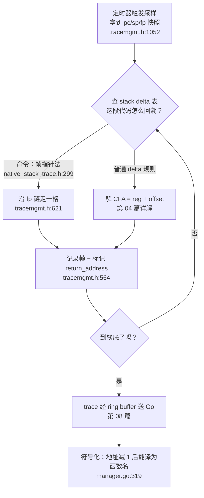

# 03 栈回溯入门：帧指针与调用栈

> 系列导航：上一篇《02 Go 与 eBPF 的对话：加载、配置与事件通道》讲了用户态与内核态如何协作；本篇开始深入这个项目真正的核心——**栈回溯（stack unwinding）**。

## 本篇目标

读完本篇，你将能够：

- 用自己的话解释什么是调用栈、栈帧、返回地址、帧指针（FP）和 CFA；
- 画出一个 x86-64 函数调用时的栈布局图；
- 手算一次「帧指针链回溯」的每一步；
- 读懂 eBPF 代码 `unwinder_unwind_frame_pointer`（`support/ebpf/tracemgmt.h:621`）的每一行，并知道它在整个回溯流程中的位置；
- 解释 `-fomit-frame-pointer` 为什么会让帧指针回溯失效，以及为什么生产环境几乎都踩这个坑；
- 解释为什么返回地址在符号化之前要「减 1」，以及 `return_address` 标志是如何从 eBPF 一路传到 Go 的；
- 建立本篇最重要的心智模型：**回溯 = 反复求解 CFA 方程**，为第 04 篇的 Stack Delta 机制铺路。

## 前置知识（名词解释集中区）

本篇会密集出现一批体系结构名词，先在这里集中解释，正文中遇到时可以随时翻回来。

> **名词解释：调用栈（call stack）**
> 每个线程都有的一块内存区域，用来记录「函数调用了谁」。`main` 调用 `foo`，`foo` 调用 `bar`，栈上就依次叠着 `main`、`foo`、`bar` 三块信息。栈向低地址方向生长（新调用的函数占据更低的地址）。

> **名词解释：栈帧（stack frame / frame）**
> 一次函数调用在栈上占用的那段内存，就是这个函数的「栈帧」。里面通常装着：返回地址、保存的寄存器、局部变量、给被调用者准备的参数。一个调用栈就是一串首尾相接的栈帧。回溯的本质，就是从最顶层的栈帧出发，逐个找出「下一层栈帧在哪、它对应的代码地址是什么」。

> **名词解释：寄存器（register）**
> CPU 内部的超高速存储单元，容量极小（x86-64 通用寄存器只有十几个，每个 8 字节）。本篇关心四个：
> - **pc（program counter，程序计数器）**：x86-64 上叫 `rip`，存「当前正在执行的指令地址」；
> - **sp（stack pointer，栈指针）**：x86-64 上叫 `rsp`，指向栈顶（当前栈的最低已用地址）；
> - **fp（frame pointer，帧指针）**：x86-64 上叫 `rbp`，指向当前栈帧的固定锚点（后面详解）；
> - **lr（link register，链接寄存器）**：ARM64（aarch64）上叫 `x30`，调用函数时硬件自动把返回地址存进这个寄存器（x86 则是把返回地址压栈，两者风格不同，所以项目代码里 aarch64 分支常单独处理 `lr`）。

> **名词解释：调用约定（calling convention）**
> 一份「函数之间怎么交接」的协议：参数放哪（寄存器还是栈）、返回值放哪、谁负责清理栈、哪些寄存器必须保存后恢复。x86-64 Linux 遵循 System V AMD64 ABI。只有大家都遵守同一份协议，编译器生成的代码才能互相调用，回溯器也才有规律可循。

> **名词解释：CFA（Canonical Frame Address，规范帧地址）**
> 来自 DWARF 调试信息规范的术语：一个函数的 CFA 定义为「调用发生那一刻、call 指令执行之前 caller 的 sp 值」。直觉理解：**CFA 就是本栈帧的「天花板」——跨过它，就进入了上一层调用者的地盘**。返回地址就保存在 `CFA - 8` 这个位置。它是所有回溯算法的统一坐标系。

> **名词解释：stripped binary（去符号二进制）**
> 编译后用 `strip`（或链接选项）把符号表（函数名、变量名等信息）删掉的二进制文件。体积更小，但没有函数名。生产环境发布的二进制和系统库几乎全是 stripped 的。这对 profiler 意味着：拿到地址后「这个地址属于哪个函数」要靠别的途径解决（第 07 篇会讲符号化），而本篇只需要记住：回溯阶段我们只产出**地址**，名字是后面的事。

> **名词解释：回溯 / 栈回溯（unwinding / stack unwinding）**
> 从当前执行点出发，沿着调用链反推出「谁调用了谁」的完整序列的过程。你在调试器里按 `bt`（backtrace）看到的调用栈，就是回溯的结果。对 profiler 来说，每次采样都要做一次回溯。

### 一个类比

把整个机制想象成**楼里的消防疏散图**：

- 每个栈帧是楼里的一个房间，CFA 是房间天花板的标高；
- 「返回地址」是贴在门框上的纸条：「事情办完后回到楼下哪个房间继续干活」；
- 帧指针回溯，相当于每个房间里都钉了一块牌子写着「下一层房间的门牌号」（保存的 caller FP）；
- `-fomit-frame-pointer` 就是装修时**把牌子全拆了**——房间还在、纸条还在，但你得靠每间房的户型图纸（Stack Delta）才能算出天花板有多高、纸条贴在哪。

## 为什么 profiler 必须懂回溯

第 01 篇说过，这个 profiler 的采样方式很暴力：定时器一响，eBPF 程序在被打断的线程上原地启动，拿到的原始材料只有一份寄存器快照。在 `copy_state_regs`（`support/ebpf/tracemgmt.h:1042`）里，x86-64 分支把被打断线程的三个关键寄存器搬进状态结构体：

```c
// support/ebpf/tracemgmt.h:1052-1054
state->pc  = regs->ip;
state->sp  = regs->sp;
state->fp  = regs->bp;
```

注释里把 `UnwindState`（`support/ebpf/types.h:736`）称为「Container for unwinding state」——回溯状态容器。它的开头是一个 union，把 `pc / sp / fp / lr` 等寄存器都收编进来（`support/ebpf/types.h:745`）。

也就是说，**一次采样的输入只有三个数：pc、sp、fp**。profiler 的任务是从这三个数出发，把整条调用链上的每一个 pc 都挖出来。怎么挖？这就是本篇的正题。

## 最小实验程序与 x86-64 栈布局

先写一个 10 行的 C 程序，我们会在它身上把整套概念过一遍：

```c
// chain.c —— 编译：gcc -O0 -fno-omit-frame-pointer -g chain.c -o chain
#include <stdio.h>

int level2(int x) { return x * 2; }       // 最内层：叶子函数
int level1(int x) { return level2(x) + 1; }
int level0(int x) { return level1(x) + 1; }

int main(void) {
    int r = level0(40);
    printf("%d\n", r);                     // 83
    return 0;
}
```

用 `-O0` 加 `-fno-omit-frame-pointer` 编译（这两个选项的含义马上就会讲），反汇编 `level1` 可以看到每个函数开头都有这样一对经典指令（**函数序言，prologue**）：

```asm
push   %rbp            ; 把 caller 的 fp 存到栈上
mov    %rsp, %rbp      ; 让 fp 指向这里，作为本帧的锚点
...                    ; 函数体：sub $16, %rsp 分配局部变量，然后 call level2
leave                  ; 结尾的「函数尾声，epilogue」：恢复 sp 和 fp
ret                    ; 弹出返回地址，跳回 caller
```

### 画出栈布局

假设程序执行到 `level2` 函数体中间被打断（这正是 profiler 采样的时机），此刻栈从低地址（栈顶）到高地址（栈底）长这样：

```
  低地址（栈顶，sp 在这里）
  ┌──────────────────────────────┐
  │ level2 的栈帧                 │
  │   ...局部变量...              │
sp├─ - - - - - - - - - - - - - - ┤
  │   fp2 ─────────────┐         │   fp2 是当前 rbp 的值
  ├────────────────────┼─────────┤◄── rbp (= fp2)
  │ 保存的 fp1         │◄────────┘   ← *fp2：caller 的帧指针
  ├────────────────────┤
  │ 返回地址 → level1  │           ← *(fp2 + 8)：call level2 的下一条指令
  ├════════════════════┤═══════════  ← fp2 + 16 = level1 栈帧的 CFA
  │ level1 的栈帧       │
  │   ...局部变量...    │
  ├────────────────────┤
  │   fp1 ──────────┐  │
  ├─────────────────┼──┤◄── fp1
  │ 保存的 fp0      │◄─┘            ← *fp1
  ├─────────────────┤
  │ 返回地址→level0 │               ← *(fp1 + 8)
  ├═════════════════┤══════════════  ← fp1 + 16 = level0 栈帧的 CFA
  │ level0 的栈帧    │
  │      ...        │
  ├─────────────────┤
  │ 返回地址→main   │
  ├─────────────────┤
  │ main 的栈帧      │
  └─────────────────┘
  高地址（栈底）
```

盯住这张图，记住三个不变量（x86-64、带帧指针时成立）：

1. `*(fp)` = caller 的帧指针（`push %rbp` 存的）；
2. `*(fp + 8)` = 返回地址（`call` 指令自动压栈的）；
3. `fp + 16` = 本帧的 CFA = caller 在 call 之前的 sp。

所谓「帧指针链」，就是不变量 1：每个栈帧里都存着上一层的 fp，像链表一样一路串到 `main`。

## 帧指针链回溯：先用人脑跑一遍

给定 `(pc, sp, fp)`，回溯算法就是三行伪代码的循环：

```
loop:
    记录当前 pc                    ← 这一帧「在哪个函数里」
    caller_fp = *(fp)              ← 不变量 1：取链表的 next 指针
    pc        = *(fp + 8)          ← 不变量 2：caller 执行到哪了
    sp        = fp + 16            ← 不变量 3：跨过本帧，回到 caller 的栈顶
    fp        = caller_fp
```

每一步都是从「当前帧」解出「上一层帧」的 `(pc, sp, fp)`，直到 fp 变成 0 或读内存失败（说明到头了）。

把第三步换个写法：`新的 sp = 旧的 fp + 16`。再对照 CFA 的定义——「call 执行前 caller 的 sp」——你会发现：**帧指针回溯里，新 sp 恰好等于本帧的 CFA**。这不是巧合，这是所有回溯算法的通用形态：

> **心智模型：回溯的每一步，都是在解一道 CFA 方程。**
> 「已知当前帧的某个锚点（这里是 fp），求本帧的 CFA（= 上一层的 sp），然后到 CFA - 8 处取返回地址。」帧指针只是解这道方程的一种特别省事的已知条件。

## 真实代码：unwinder_unwind_frame_pointer

现在看 eBPF 里的实现，它就 10 行，在 `support/ebpf/tracemgmt.h:621-630`：

```c
// support/ebpf/tracemgmt.h:621-630
// unwinder_unwind_frame_pointer unwinds using the Frame Pointer.
static inline EBPF_INLINE bool unwinder_unwind_frame_pointer(UnwindState *state)
{
  u64 regs[2];

  if (bpf_probe_read_user(regs, sizeof(regs), (void *)state->fp)) {
    return false;
  }
  return unwinder_unwind_frame_pointer_regs(state, regs);
}
```

逐行解释：

- `u64 regs[2];`：准备一个 16 字节的缓冲区，恰好装两个 8 字节值。对照上面的栈图——`fp` 指向的两个槽位，正是「保存的 caller fp」和「返回地址」。一次读取，两样全拿。
- `bpf_probe_read_user(regs, sizeof(regs), (void *)state->fp)`：eBPF 程序运行在内核态，不能直接解引用用户态指针，必须通过 `bpf_probe_read_user` 这个内核助手函数「安全地」从用户进程内存读 16 字节。读失败（比如 fp 已经指向无效地址，说明栈到头或数据损坏）就返回 `false`，本次回溯就此终止。
- 成功后委托给 `unwinder_unwind_frame_pointer_regs`（`support/ebpf/tracemgmt.h:596-619`）完成状态迁移：

```c
// support/ebpf/tracemgmt.h:598-618（节选，x86-64 分支）
u64 fp = state->fp;

// On x86-64 the epilogue and prologue guarantee that sp correlates to
// the frame pointer. Only return address, and previous FP are pushed
// to the stack when the frame pointer is set from the stack pointer.
state->sp = fp + 2 * sizeof(u64);
...
// At least RA and FP must be in the Frame.
state->fp_bound = fp + 2 * sizeof(u64);
state->fp       = regs[0];
state->pc       = normalize_pac_ptr(regs[1]);
unwinder_mark_nonleaf_frame(state);
return true;
```

对照前面的三个不变量，一一印证：

- `state->sp = fp + 2 * sizeof(u64)`（`tracemgmt.h:604`）：即 `sp = fp + 16`，正是**不变量 3——新 sp = 本帧 CFA**。注意代码注释的精神：x86-64 上函数序言/尾声保证了 fp 和 sp 的固定关系，所以才能这样算；aarch64 分支（`tracemgmt.h:605-612`）明确写着「不做这种假设」，把 sp 置 0 留给后续机制恢复——架构差异就体现在这里。
- `state->fp = regs[0]`（`tracemgmt.h:615`）：新 fp = `*fp`，**不变量 1**。
- `state->pc = normalize_pac_ptr(regs[1])`（`tracemgmt.h:616`）：新 pc = `*(fp + 8)`，**不变量 2**。`normalize_pac_ptr`（`tracemgmt.h:227`）用于剥掉 ARM64 指针认证（PAC）的标签位，x86-64 上是恒等操作，本篇可先忽略。
- `fp_bound`（`tracemgmt.h:614`）记录帧大小的下界，供 `unwinder_check_frame_size`（`tracemgmt.h:585`）做健全性检查（防止损坏的 fp 指向十万八千里外），细节不必现在掌握。
- 最后一行 `unwinder_mark_nonleaf_frame(state)` 非常重要，单独一节讲。

### 这个函数什么时候被调用？

注意一个关键事实：`unwinder_unwind_frame_pointer` **不是** native 回溯的主路径默认动作，它是一条「命令」的处理分支。在 `unwind_one_frame` 里（`support/ebpf/native_stack_trace.h:299-303`）：

```c
// support/ebpf/native_stack_trace.h:299-303
case UNWIND_COMMAND_FRAME_POINTER:
  if (!unwinder_unwind_frame_pointer(state)) {
    goto err_native_pc_read;
  }
  goto frame_ok;
```

这里的 `UNWIND_COMMAND_FRAME_POINTER` 是常量 4（`support/ebpf/types.h:1058`，注释原文「Unwind using standard frame pointer」）。它的含义是：用户态 Go 进程预先分析过这个可执行文件，知道「在这段代码区域，函数是带帧指针的」，于是往 stack delta 表里填了这条命令；eBPF 回溯到这里时，查表查出命令 4，就走帧指针链回溯。

换句话说：**profiler 对每一个地址，先查「这块代码该用哪种方式回溯」，查到「帧指针法」才用帧指针**。这个「查表决定方法」的架构正是第 04 篇 Stack Delta 的全貌，这里你只需记住命令分发的存在。

## return_address 标志：为什么返回地址要「减 1」

### 一个微妙的语义问题

回到伪代码的第二行：`pc = *(fp + 8)`。取出来的「返回地址」到底是什么？

`call` 指令的语义是：把**下一条指令**的地址压栈，再跳转。所以返回地址指向的是 call **之后**的那条指令——它是「执行恢复后要去的地方」，而不是「发起调用的那条指令本身」。

这带来一个实际后果：符号化时，如果直接拿返回地址去查「这个地址属于哪个函数/哪一行」，可能查到错误的答案。一个经典场景：`foo()` 里的 `call bar` 恰好是 `foo` 函数的最后几条指令，返回地址可能已经越出了 `foo` 的边界，落在链接器排布的**下一个函数**的第一条指令上——回溯结果就会张冠李戴，把这一帧显示成别的函数。

### 项目里的三处配合

这个项目的解法分三步，横跨 eBPF 和 Go 两端，非常值得一读：

**第一步：标记。** 每次通过回溯（而非采样快照）得到一个 pc 时，都调用 `unwinder_mark_nonleaf_frame`（`support/ebpf/tracemgmt.h:553-570`）：

```c
// support/ebpf/tracemgmt.h:553-570（节选）
// On both x86 and aarch64, this means we need to subtract 1 from
// the address during later processing.
static inline EBPF_INLINE void unwinder_mark_nonleaf_frame(UnwindState *state)
{
  state->return_address = true;
  ...
}
```

它做的事就是把 `UnwindState.return_address` 标志置真（`support/ebpf/types.h:770-774` 的注释写明：「Set if the PC is a return address... requires to be adjusted during symbolization」）。「nonleaf（非叶子）」这个名字很贴切：帧指针链解出来的帧都**调用过别人**，所以是调用树上的非叶子节点；它们手里的 pc 全是 call 压栈的返回地址。

**第二步：携带。** 每个 native 帧被写入 trace 时，标志随帧一起打包。`unwind_native` 里调用（`support/ebpf/native_stack_trace.ebpf.c:166-171`）：

```c
error = push_native(
  &record->state,
  trace,
  record->state.text_section_id,
  record->state.text_section_offset,
  record->state.return_address);
```

`push_native`（`support/ebpf/tracemgmt.h:691-702`）把它转成帧头里的 `FRAME_FLAG_RETURN_ADDRESS` 标志位（`support/ebpf/frametypes.h:43`，值为 `1U << 1`）。

**第三步：修正。** Go 端符号化时检查这个标志并减 1。通用路径在 `processmanager/manager.go:305-321`，注释写得极好，原文照录其义：

```go
// processmanager/manager.go:305-321（节选注释）
// Return addresses are where execution resumes when returning to the stack
// frame and point to the **next instruction** after the call instruction
// that produced the frame.
// For these return addresses we subtract 1 from the address in order to
// make it point into the call that precedes it ...
if ef.Flags().ReturnAddress() {
    address--
}
```

Go 专属符号化路径也有同样处理（`interpreter/go/symbolize.go:52-54`）。标志的读取通过 `libpf/frameflags.go:17-19` 的 `ReturnAddress()` 方法。

为什么只减 1 而不是减去整条 call 指令的长度？`manager.go:316-318` 的注释坦白了：x86 是变长指令集，**反向反汇编几乎不可靠**；而「减 1」得到的地址一定落在 call 指令的最后一个字节上——对「属于哪个函数、对应哪一行」的判断来说已经足够了。这是一个教科书级的工程权衡：用最小的成本换取符号化的正确归属。

### 同一个标志的第二个用途

`return_address` 不只服务于符号化。在 `get_stack_delta` 里（`support/ebpf/native_stack_trace.h:64`）：

```c
unsigned long offset = state->text_section_offset - (unsigned long)state->return_address;
```

查 stack delta 表之前，先把返回地址减 1（`bool` 转整数即减 0 或 1）。原因类似：stack delta 表是按「指令地址 → 回溯规则」组织的，返回地址可能已经跨过了一条规则的边界（比如落在下一段代码区间的第一条指令），减 1 把它拉回 call 指令的势力范围，保证查到的是正确的回溯规则。这个表是什么、怎么来的，正是第 04 篇的主角。

## -fomit-frame-pointer：为什么现实世界的栈上没有帧指针

### 优化本身

x86-64 上维护帧指针的成本是：每个函数多两条序言指令，并且 **`rbp` 被永久占用**，不能参与通用运算。寄存器是极其稀缺的资源，腾出一个 `rbp` 对寄存器分配器意义重大。因此 GCC 从 2012 年前后起，在 `-O1` 及以上优化级别**默认开启** `-fomit-frame-pointer`（FPO，省略帧指针）：不生成序言，函数里 `rbp` 变成普通通用寄存器。

### 为什么生产环境普遍没有帧指针

- 发行版的系统库（libc、libssl……）和你 `apt install` 的一切，几乎都是默认优化级别编译的；
- 各大厂商发布的二进制同理；
- 后果是：对一台真实服务器做全系统 profiling，绝大多数进程的绝大多数栈帧上，**`rbp` 只是个普通寄存器，里面装的是天知道什么数据**。

如果 profiler 无脑信任 fp 去走链表，轻则读出垃圾、栈走飞，重则给出完全错误（但看起来很逼真）的调用栈。所以工业级 profiler 不能把帧指针当默认方案。

这也正是本项目架构的由来：默认走 **Stack Delta**（从 `.eh_frame` 推导出的、不依赖运行时寄存器的回溯规则表，第 04 篇详解），只有当用户态预先确认某段代码确实带帧指针时，才在表里写下 `UNWIND_COMMAND_FRAME_POINTER`，让 eBPF 走本篇讲的这条捷径。帧指针回溯在这里是一种「被验证过才敢用」的快车道。

### 一个容易混淆的点：stripped 与 FPO 是两回事

- **stripped** 删掉的是符号表（函数名），影响的是「地址 → 名字」的翻译，不影响回溯本身；
- **FPO** 删掉的是运行时的帧指针链，直接影响回溯能否进行。

生产二进制通常两者皆是，所以 profiler 必须在没有符号、也没有帧指针的双重不利条件下工作——这正是这个项目的价值所在。

## 心智模型沉淀：回溯 = 反复求解 CFA 方程

把本篇串成一句话：

> **栈回溯就是循环求解方程「CFA = f(当前状态)」，解出 CFA 后，到 `CFA - 8` 处取上一层的 pc，并用 CFA 作为上一层的 sp；如此往复，直到栈底。**

本篇里，`f` 是最简单的形式：因为帧指针存在，方程是 `CFA = fp + 16`（`tracemgmt.h:604`）。第 04 篇你会看到，`f` 可以推广成「`CFA = 某寄存器 + 某偏移`」的一般表达式，系数从 DWARF 调试信息预先生成——没有帧指针时，方程照样可解。

用一个 mermaid 图总结一次采样的完整旅程（前三步本篇已覆盖，后两步留给后续篇章）：



## 动手实验

以下实验只需要一台 Linux 机器（或 WSL），不需要编译本项目。

**实验 1：亲眼看到帧指针链**

把本文的 `chain.c` 分别编译两次，对比反汇编：

```bash
gcc -O0 -fno-omit-frame-pointer -g chain.c -o chain_fp
gcc -O2 chain.c -o chain_fpo        # 默认 FPO
objdump -d chain_fp | grep -A5 '<level1>:'
objdump -d chain_fpo | grep -A5 '<level1>:'
```

观察：前者有 `push %rbp; mov %rsp,%rbp`，后者没有。想想后者的 `rbp` 被拿去干什么了。

**实验 2：用 gdb 手工走一遍链表**

```bash
gcc -O0 -fno-omit-frame-pointer -g chain.c -o chain_fp
gdb ./chain_fp
(gdb) break level2
(gdb) run
(gdb) info registers rbp rsp rip
(gdb) x/2gx $rbp        # 第一个字 = caller 的 fp，第二个字 = 返回地址
(gdb) x/2gx *(void**)$rbp   # 再走一层
(gdb) bt                # 对照 gdb 自己的回溯结果
```

你会发现手工 `x/2gx` 逐层解出来的返回地址链，和 `bt` 显示的调用栈完全对应——你刚刚人肉执行了 `unwinder_unwind_frame_pointer`。

**实验 3：感受返回地址「减 1」的必要性**

在 gdb 里 `info line *<某个返回地址>`，再 `info line *<该地址 - 1>`，对比两者给出的源代码行。很多时候相同，但如果 call 恰好是函数末尾的调用（尾调用附近的场景），你会看到减 1 前后的行号归属不同。这就是 `manager.go:319` 那句 `address--` 存在的理由。

**实验 4（思考题，不需要执行）**：如果二进制是 stripped + FPO 的，gdb 的 `bt` 靠什么回溯？（提示：`.eh_frame` 段通常不会被 strip 掉。答案正是第 04 篇的内容。）

## 小结

- 调用栈由栈帧首尾相接而成；**CFA** 是每个栈帧的「天花板」，返回地址恒在 `CFA - 8`；
- 帧指针回溯依赖三个不变量：`*fp` 是上一层 fp、`*(fp+8)` 是返回地址、`fp+16` 是本帧 CFA；
- 真实代码 `unwinder_unwind_frame_pointer`（`support/ebpf/tracemgmt.h:621`）就是这三个不变量的直译：一次 `bpf_probe_read_user` 读出 16 字节，更新 `sp/fp/pc`，然后打上 nonleaf 标记；
- 回溯出来的 pc 是**返回地址**，指向 call 的下一条指令；项目用 `return_address` 标志（`tracemgmt.h:564` 标记 → 帧头携带 → `manager.go:319` 与 `native_stack_trace.h:64` 消费）在查表和符号化时把它「减 1」拉回调用指令的势力范围；
- `-fomit-frame-pointer` 在生产环境无处不在，帧指针链默认不可信——它只是本项目回溯工具箱里被验证后才启用的一条快车道（`UNWIND_COMMAND_FRAME_POINTER`，`native_stack_trace.h:299`）；
- 最重要的带走一句：**回溯 = 反复求解 CFA 方程**。帧指针只是让方程的解显而易见。

## 下一篇预告

**《04 Stack Delta：没有帧指针也能回溯的秘密》**。当 `rbp` 被编译器挪作他用、栈上没有任何链条可循时，怎么知道当前栈帧有多高？答案是：不猜，**算**。用户态 Go 提前解析每个可执行文件的 `.eh_frame`（DWARF 展开信息），把它压缩成「地址区间 → CFA 方程参数」的 stack delta 表下发给 eBPF；内核态每回溯一格就查一次表（你已经在 `get_stack_delta` 里见过它的入口了）。我们将完整走一遍这条链路：从 DWARF CFI 规则，到 `UnwindInfo` 结构体，再到二分查找 delta 的 16 步上限——看完你会明白，为什么这个项目能在生产环境的全 stripped、全 FPO 机器上稳定回溯。
