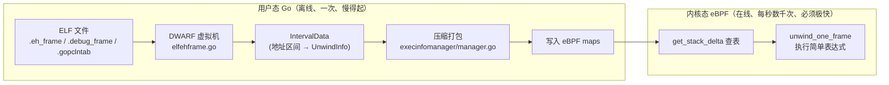
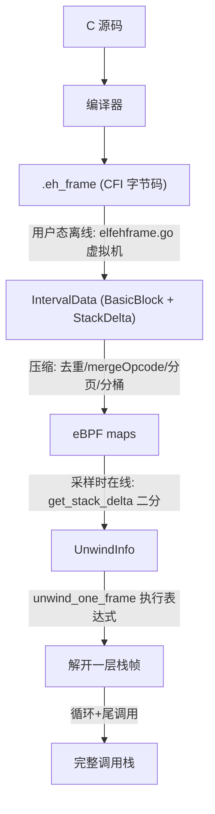

# 04 Stack Delta：没有帧指针也能回溯的秘密

> 系列导航：上一篇《03 栈回溯入门：帧指针与调用栈》讲了最理想的回溯方式；本篇面对残酷的现实——生产环境的二进制大多**没有帧指针**。这是整个项目最核心、最精妙的一篇，建议泡杯茶慢慢读。

## 本篇目标

读完本篇，你将能够：

- 说清 `.eh_frame` 和 DWARF CFI 是什么、为什么 strip 过的二进制里它还在；
- 理解为什么不能在内核里直接解释 DWARF 字节码，以及"用户态离线翻译 + 内核态查表执行"的分工设计；
- 逐字段读懂内核态的两个核心数据结构 `UnwindInfo` 与 `StackDelta`；
- 走完内核查找一条回溯规则的完整路径：64KB 分页 → map-in-map 桶 → 16 步手工展开二分；
- 逐行读懂 `unwind_one_frame` 这个"每解开一层栈帧"的函数，包括 STOP / PLT / SIGNAL / GO_MORESTACK 四种特殊命令；
- 通过一个具体 C 函数，把「C 代码 → CFI 规则 → StackDelta → 内核执行」的全链路串起来。

## 前置知识（名词解释集中区）

> **DWARF**：一种调试信息格式标准，编译器用它把"源码行号、变量位置、栈帧布局"等信息写进 ELF 文件，供 gdb 等调试器使用。它由一套紧凑的字节码（bytecode）描述，需要一个小型虚拟机来解释执行。可以类比为：DWARF 是给调试器看的"压缩存档"，解压规则写在存档自己里面。

> **CFI（Call Frame Information，调用帧信息）**：DWARF 的一个子集，专门描述"在函数执行到任意位置时，如何找到上一层栈帧"。它的实体是 `.eh_frame` / `.debug_frame` 这两个 ELF 节（section）。

> **CFA（Canonical Frame Address，规范帧地址）**：CFI 里的锚点概念——约定俗成地取"调用本函数瞬间的栈顶地址"，也就是**上一层栈帧的底部、返回地址存放处再往上一个指针的位置**。每个程序位置都有一条规则告诉你怎么算 CFA（通常是 `CFA = 某个寄存器 + 偏移`）。有了 CFA，返回地址几乎总在 `CFA - 8`（x86-64）处，上一层的栈指针就是 CFA 本身——一层的回溯就完成了。

> **PLT（Procedure Linkage Table，过程链接表）**：动态链接的跳板区。调用 `libc` 里的函数时，代码先跳到本模块的 PLT 桩（stub），再由它跳到共享库里的真实函数。PLT 是编译器生成的固定模板代码，栈布局特殊，需要特殊处理。

> **信号帧（signal frame）**：进程收到 Unix 信号时，内核会在用户栈上"伪造"一帧，把被打断时刻的全部寄存器（PC、SP、FP……）保存进 `rt_sigframe` 结构，然后让进程跳进信号处理函数。回溯穿过这一帧时，不能按普通函数处理，而要从这个结构里把寄存器原样恢复出来。

> **map-in-map**：eBPF 的一种嵌套映射结构（`BPF_MAP_TYPE_HASH_OF_MAPS`），外层 map 的值本身又是一个 map。类比：一本通讯录（外层 map），翻到的每一页本身又是一张完整的表格（内层 map）。它让"按容量分桶存储"成为可能。

> **verifier（验证器）**：内核对每个 eBPF 程序做的静态安全检查器，第 01 篇已经见过。与本篇相关的两条铁律：**禁止无界循环**（循环次数必须能被静态证明有上界）、**禁止不可验证的复杂数据流**。这直接决定了 DWARF 字节码不可能在内核里解释。

## 一、为什么帧指针会消失

第 03 篇的回溯方法依赖一条链：`RBP → 上一层 RBP → 再上一层 ……`。但从 GCC 4.6 起，x86-64 的 `-O1` 及以上优化级别默认开启 **FPO（Frame Pointer Omission，帧指针省略）**——编译器把 RBP 省下来当通用寄存器用，函数的序言里不再有 `push %rbp; mov %rsp, %rbp`。

这是有充分理由的：x86-64 一共只有 16 个通用寄存器，让出一个能给热点代码带来几个百分点的性能提升。于是今天你在服务器上 `strip` 过的发行版二进制——glibc、libcrypto、你自己的 C/C++ 服务——绝大多数都没有帧指针链。

没有 RBP 链，靠"猜"是不行的。但别忘了：**栈的布局是编译器安排的，编译器自己知道每个位置栈有多深**。问题是——这个知识被写在了哪里？能不能被我们白嫖？

## 二、.eh_frame：意外的宝藏

答案是 `.eh_frame`。这个 ELF 节的存在理由和调试毫无关系：**C++ 异常处理需要它**。`throw` 一个异常时，运行时库必须能逐层回溯栈、调用每层的析构函数，直到找到匹配的 `catch`。这个过程要求"任意程序位置都能算出上一层栈帧"，于是编译器把完整的 CFI 规则写进了 `.eh_frame`，并且它是**运行时必需数据**——跟随 `.text` 一起被加载进内存。

关键推论：`strip` 命令默认只删掉符号表和 `.debug_*` 调试节，**`.eh_frame` 会被保留**，因为删掉它 C++ 异常就坏了。这意味着：

- 不需要安装 debuginfo 包；
- 不需要保留符号表；
- 不需要帧指针；
- 几乎每个现代 Linux 二进制（glibc 的汇编文件都手写了 CFI 伪指令）都自带回溯所需的全部信息。

项目自带的 README 把这个发现讲得很直白（`nativeunwind/elfunwindinfo/README.md:23-28`）：现代 ELF 可执行文件在 `.eh_frame` 节里拥有获取 stack delta 所需的全部信息，"it is placed there to enable stack unwinding for C++ exceptions. This is very useful for us."。这套"利用 `.eh_frame` 做低开销全系统回溯"的思路，也正是 Elastic 的专利 **US11604718B1** 所记载的核心方案——本项目就是这一思路的开源实现（项目由 Elastic 捐赠给 OpenTelemetry）。

## 三、为什么 DWARF 字节码必须搬到用户态

既然信息都在，为什么不在 eBPF 程序里直接解析 `.eh_frame`？看一眼 DWARF 的真实面目就知道了。CFI 本质上是一台小型虚拟机的字节码，项目 Go 代码里枚举了要支持的操作码（`nativeunwind/elfunwindinfo/elfehframe.go:60-92`）：

```go
const (
	cfaNop                  cfaOpcode = 0x00
	cfaSetLoc               cfaOpcode = 0x01
	cfaAdvanceLoc1          cfaOpcode = 0x02
	...
	cfaDefCfa               cfaOpcode = 0x0c
	cfaDefCfaRegister       cfaOpcode = 0x0d
	cfaDefCfaOffset         cfaOpcode = 0x0e
	cfaDefCfaExpression     cfaOpcode = 0x0f
	cfaExpression           cfaOpcode = 0x10
	...
)
```

解释它需要一个带状态（当前位置、CFA 规则、各寄存器规则）的虚拟机、一个 remember/restore 状态栈、LEB128 变长解码，以及任意长度的 DWARF 表达式求值器（栈式指令，见 `elfehframe.go:200-238` 的 `expression()`）。用户态实现是一个 130 行的大 `switch`（`elfehframe.go:534-650` 的 `state.step`）。

这些每一样都踩在 verifier 的禁区上：

- **数据长度不可静态确定**——一个 ELF 的 `.eh_frame` 可以有几十万个 FDE（Frame Description Entry，帧描述项），解释循环的次数上限无法证明；
- **需要任意量内存和复杂指针追踪**——eBPF 程序只有 512 字节栈和有限的 map 访问；
- **表达式求值是图灵完备的栈机**——verifier 不可能放过。

所以正确的架构分工是（这也是全项目反复出现的设计哲学）：



用户态把"语言丰富但解释昂贵"的 DWARF **编译**成"表达能力弱但执行 O(1)"的自定义格式——Stack Delta。内核每解开一层栈帧，只需要：查两次 map、算一条 `寄存器+偏移` 的表达式、读一次栈内存。

## 四、ExtractELF：用户态翻译器的入口与信息源优先级

翻译器的入口在 `nativeunwind/elfunwindinfo/stackdeltaextraction.go:150-156`：

```go
// ExtractELF takes a pfelf.Reference and provides the stack delta
// intervals for it in the interval parameter.
func ExtractELF(elfRef *pfelf.Reference) (*sdtypes.IntervalData, error) {
	elfFile, err := elfRef.GetELF()
	if err != nil {
		return nil, err
	}
	return extractFile(elfFile, elfRef)
}
```

`extractFile`（`stackdeltaextraction.go:160-203`）按**固定优先级**依次尝试多个信息源（`stackdeltaextraction.go:183-198`）：

```go
	if err := ee.parseGoPclntab(); err != nil {
		return nil, fmt.Errorf("failure to parse golang stack deltas: %v", err)
	}
	if err := ee.parseEHFrame(); err != nil {
		return nil, fmt.Errorf("failure to parse eh_frame stack deltas: %v", err)
	}
	if err := ee.parseDebugFrame(elfFile); err != nil {
		return nil, fmt.Errorf("failure to parse debug_frame stack deltas: %v", err)
	}
	if ee.ref != nil && len(intervals.Blocks) < numBlocksToOmitDebugLink {
		// There is only few stack deltas. See if we find the .gnu_debuglink
		// debug information for additional .debug_frame stack deltas.
		if err := ee.extractDebugDeltas(); err != nil {
			return nil, fmt.Errorf("failure to parse debug stack deltas: %v", err)
		}
	}
```

优先级解读（从高到低）：

1. **`.gopclntab`**：Go 编译器自带的栈回溯元数据（Go 运行时的 GC 和 panic 都靠它），对 Go 函数**比 `.eh_frame` 更准确**。所以先解析它，之后 `fdeHook` 会丢弃被它覆盖的 `.eh_frame` FDE（`stackdeltaextraction.go:44-61`：`// Drop FDEs inside the gopclntab area`）。
2. **`.eh_frame`**：C/C++/Rust 的主力来源。
3. **`.debug_frame`**：内嵌的调试版 CFI，补充 `.eh_frame` 没覆盖的部分。
4. **`.gnu_debuglink` 外部调试文件**：只有当提取结果太少（基本块数 < 8，见 `stackdeltaextraction.go:20` 的 `numBlocksToOmitDebugLink`）时才顺着 debuglink 去找外部 debug 文件——很多生产系统根本没装调试包，所以错误被有意忽略（`stackdeltaextraction.go:91-94`）。

另外还有一个细节：`extractFile` 开头会识别 ELF 入口点（`_start`）的机器码，人工合成一条 STOP 标记（`stackdeltaextraction.go:171-182`）——栈回溯到这里必须停下，再往上就是虚无了。对 musl 这类入口代码没有 FDE 的 libc 尤其重要。

每个 FDE 被解析成一个 `BasicBlock`：一段地址区间 + 一串 `(偏移, UnwindInfo)` 增量，增量只在"规则发生变化的位置"记录（`elfehframe.go:917-937` 的 `parseFDE` 主循环）。遇到信号跳板（内核或 libc 注入的 `rt_sigreturn` 代码，用字节序列精确匹配，见 `elfehframe.go:317-339` 的 `sigretCodeMap`），整条 FDE 直接标记为 `UnwindInfoSignal`（`elfehframe.go:922-925`）。

## 五、核心数据结构：UnwindInfo 与 StackDelta 逐字段

翻译的产物是两个内核态结构，定义在 eBPF 与 Go 共享的头文件里。

### UnwindInfo：解开一层帧所需的全部知识

`support/ebpf/types.h:979-988`：

```c
// UnwindInfo contains the unwind information needed to unwind one frame
// from a specific address.
typedef struct UnwindInfo {
  u8 flags;       // flags: UNWIND_FLAG_*
  u8 baseReg;     // base register to calculate CFA from
  u8 auxBaseReg;  // base register to calculate FP (x86-64) or RA[+FP] (aarch64)
  u8 mergeOpcode; // opcode for generating next stack delta, see below
  s32 param;      // parameter for the CFA expression
  s32 auxParam;   // parameter for the FP expression
} UnwindInfo;
```

逐字段讲解：

| 字段 | 含义 | 举例（x86-64 普通函数） |
|---|---|---|
| `flags` | 修饰位：本条是普通表达式还是特殊命令、CFA 是否需要解引用、是否只对叶子函数有效 | 0（普通规则） |
| `baseReg` | 计算 CFA 的基址寄存器编号；**高 4 位还藏着 raReg**——返回地址若在某寄存器里（如 `__vfork` 把 RA 存在 `%rdi`），从这里取 | `UNWIND_REG_SP`(3) |
| `auxBaseReg` | 恢复上一层 FP（x86-64）或返回地址（aarch64）所用的基址寄存器 | `UNWIND_REG_CFA`(1) 或 `UNWIND_REG_INVALID`(0) |
| `mergeOpcode` | 相邻 delta 合并指令，为 0 表示无合并，详见第七节 | 0 或 `0x02` 等 |
| `param` | CFA 表达式的偏移参数：`CFA = regs[baseReg] + param` | 如 `48` |
| `auxParam` | FP/RA 表达式的偏移参数 | 如 `-16`（FP 存在 CFA-16 处） |

寄存器编号紧跟其后定义（`types.h:990-1005`）：`UNWIND_REG_SP=3`、`UNWIND_REG_FP=4`、`UNWIND_REG_LR=5`，外加 x86 专属的 `RAX/RDI/R8/R9/R11/R13/R15`——后面这组是给 OpenSSL 手编汇编这类"拿通用寄存器当 CFA 基址"的怪胎准备的，这类规则会打上 `UNWIND_FLAG_LEAF_ONLY`（`types.h:1011`），因为只有不调别人的叶子函数才能保证这些寄存器没被破坏。

`flags` 的四个位（`types.h:1007-1014`）：

- `UNWIND_FLAG_COMMAND (1<<0)`：本条不是表达式，是命令（STOP/PLT/SIGNAL 等），见第九节；
- `UNWIND_FLAG_FRAME (1<<1)`：aarch64 专用，栈上存在完整的 LR+FP 帧；
- `UNWIND_FLAG_LEAF_ONLY (1<<2)`：仅叶子函数可用；
- `UNWIND_FLAG_DEREF_CFA (1<<3)`：CFA 需要先解引用（见第六节）。

### StackDelta：把地址映射到规则

`support/ebpf/types.h:1030-1035`：

```c
// An array entry that we will bsearch into that keeps address and stack unwind
// info, per executable.
typedef struct StackDelta {
  u16 addrLow;    // the low 16-bits of the ELF virtual address to which this stack delta applies
  u16 unwindInfo; // index of UnwindInfo, or UNWIND_COMMAND_* if STACK_DELTA_COMMAND_FLAG is set
} StackDelta;
```

一条 StackDelta 只有 **4 个字节**，含义是："从这个地址开始（含），直到下一条 StackDelta 的地址（不含），都按 `unwindInfo` 指向的规则回溯"。两个字段的设计处处是省内存的算计：

- `addrLow` 只存地址的**低 16 位**——因为整个查找体系按 64KB（2^16）分页，页内偏移 16 位足够（页号由 key 提供，见第七节）；
- `unwindInfo` 不是内嵌一份 12 字节的 `UnwindInfo`，而是**全局数组的索引**（u16）。若最高位 `STACK_DELTA_COMMAND_FLAG = 0x8000`（`types.h:1039`）置位，则它不是索引而是直接编码的命令值。命令值里还有一类带 `STACK_DELTA_NATIVE_COMMAND_BIT = 0x4000`（`types.h:1047`），表示"只有完整版原生回溯器能实现"的命令——混合栈回溯器遇到它们要把帧上交，而不是自己硬扛。

命令清单（`types.h:1050-1064`）：`INVALID(0)`、`STOP(1)`、`PLT(2)`、`SIGNAL(3)`、`FRAME_POINTER(4)`，以及带 NATIVE 位的 `GO_ASMCGOCALL(0x4000|5)` 和 `GO_MORESTACK(0x4000|6)`——后两个用于穿透 Go 运行时的栈切换点，第 06 篇会用到。

## 六、内核支持的两种表达式

整个内核回溯器只会算两种式子。第一种是基础款（`native_stack_trace.h:162-167`）：

```c
// unwind_calc_register calculates the given basic register expression of
// format "BASE_REG + param".
static EBPF_INLINE u64 unwind_calc_register(UnwindState *state, u8 baseReg, s32 param)
{
  return state->regs[baseReg % (sizeof(state->regs) / sizeof(state->regs[0]))] + (u64)(s64)param;
}
```

`CFA = 寄存器 + param`，一行搞定。`baseReg % 数组长度` 是对畸形数据的防御：无论用户态给了什么值，数组访问都不会越界——这同时取悦了 verifier。

第二种是 x86-64 专属的解引用款（`native_stack_trace.h:188-201`）：

```c
  // Resolve the "BASE + param" before potential derereference
  u64 addr = unwind_calc_register(state, baseReg, preDeref);
  if (!deref) {
    // All done: return "BASE + param"
    return addr;
  }

  // Dereference, and add the postDereference adder.
  u64 val;
  if (bpf_probe_read_user(&val, sizeof(val), (void *)addr)) {
    DEBUG_PRINT("unwind failed to dereference address 0x%lx", (unsigned long)addr);
    return 0;
  }
  // Return: "*(BASE + preDeref) + postDeref"
  return val + postDeref;
```

形如 `CFA = *(BASE + preDeref) + postDeref`——先算地址、从目标栈上读一个指针、再加第二个偏移。什么时候需要这么绕？GCC 的 SSE 向量化函数会用 `and $-64, %rsp` 对齐栈，此时 SP 不再可预测，CFA 只能通过解引用找回（`elfehframe_x86.go:189-200` 的注释写明了这个来源）。

这里有个漂亮的编码技巧：`param` 是一个 `s32`，要塞下 preDeref 和 postDeref 两个偏移。做法是**借用低 3 位**——栈地址和 CFA 都按 8 字节对齐，param 的低 3 位天然为 0，于是拿它们存 `postDeref / 8`（`types.h:1016-1023`）：

```c
#define UNWIND_DEREF_MASK       7
// The argument after dereference is multiplied by this to allow some range.
// This assumes register size offsets are used.
#define UNWIND_DEREF_MULTIPLIER 8
```

打包/解包的 Go 侧对应物是 `PackDerefParam` / `UnpackDerefParam`（`nativeunwind/stackdeltatypes/stackdeltatypes.go:152-164`）。

## 七、四层内存压缩：全系统只花几 MB

一套 Linux 桌面上所有二进制加起来有几十万条 StackDelta。eBPF map 内存寸土寸金，项目用了四层压缩：

### 第 1 层：64KB 分页

地址空间按 64KB 分页（`types.h:1082`：`#define STACK_DELTA_PAGE_BITS 16UL`），这样 `addrLow` 只需 u16。页与数据的桥梁是 `stack_delta_page_to_info` map（`native_stack_trace.ebpf.c:134-139`）：key 是 `{fileID, 页号}`（`StackDeltaPageKey`，`types.h:1066-1070`），value 告诉内核本页的 delta 在内层数组的哪个区间、以及该去哪个桶（`StackDeltaPageInfo`，`types.h:1073-1078`）：

```c
typedef struct StackDeltaPageInfo {
  u32 firstDelta;
  u16 numDeltas;
  u16 mapID;
} StackDeltaPageInfo;
```

### 第 2 层：UnwindInfo 全局去重

几十万条 delta 里，`UnwindInfo` 的**不同取值**其实很少——绝大多数函数的序言大同小异（`CFA = SP+8`、`CFA = SP+48`……）。项目实测一台桌面系统大约只有 9700 种，于是上限设为 16384（`types.h:413-416`）：

```c
// Maximum number of unique stack deltas needed on a system. This is based on
// normal desktop /usr/bin/* and /usr/lib/*.so having about 9700 unique deltas.
// Can be increased up to 2^15, see also STACK_DELTA_COMMAND_FLAG.
#define UNWIND_INFO_MAX_ENTRIES 16384
```

所有可执行文件共享一张全局数组 `unwind_info_array`（`native_stack_trace.ebpf.c:113-120`），Go 侧用哈希表 `unwindInfoIndex map[sdtypes.UnwindInfo]uint16` 去重（`processmanager/execinfomanager/manager.go:496-504`）。于是每条 StackDelta 只存 2 字节索引。

### 第 3 层：mergeOpcode 相邻合并

编译器生成序言常常是这种节奏（push 一串寄存器，每条指令后 CFA 偏移 +8）：

```
addr+0:  CFA = SP + 8
addr+1:  CFA = SP + 16     ← push
addr+2:  CFA = SP + 24     ← push
```

三条 delta 的规则**只有 param 差 ±8、地址差 1~2 字节**。Go 侧的 `calculateMergeOpcode`（`manager.go:460-484`）检测到这个模式时，不生成新 delta，而是在前一条的 `mergeOpcode` 字段里记一笔："再往后走 N 字节（1 或 2），param 就 ±8"：

```go
func calculateMergeOpcode(delta, nextDelta sdtypes.StackDelta) uint8 {
	if delta.Info.Flags&support.UnwindFlagCommand != 0 {
		return 0
	}
	addrDiff := nextDelta.Offset - delta.Offset
	if addrDiff < 1 || addrDiff > 2 {
		return 0
	}
	if nextDelta.Info.BaseReg != delta.Info.BaseReg ||
		nextDelta.Info.AuxBaseReg != delta.Info.AuxBaseReg ||
		nextDelta.Info.AuxParam != delta.Info.AuxParam {
		return 0
	}
	paramDiff := nextDelta.Info.Param - delta.Info.Param
	switch paramDiff {
	case 8:
		return uint8(addrDiff)
	case -8:
		return uint8(addrDiff) | support.MergeOpcodeNegative
	}
	return 0
}
```

`mergeOpcode` 字节的编码（`types.h:1025-1028`）：最高位是符号（`MERGEOPCODE_NEGATIVE = 0x80`，置位表示 -8），低 7 位是与下一条 delta 的地址差。内核执行时在 `unwind_one_frame` 里应用它（`native_stack_trace.h:313-320`）：

```c
    s32 param = info->param;
    if (info->mergeOpcode) {
      DEBUG_PRINT("AddrDiff %d, merged delta %#02x", addrDiff, info->mergeOpcode);
      if (addrDiff >= (info->mergeOpcode & ~MERGEOPCODE_NEGATIVE)) {
        param += (info->mergeOpcode & MERGEOPCODE_NEGATIVE) ? -8 : 8;
        DEBUG_PRINT("Merged delta match: cfaDelta=%d", unwindInfo);
      }
    }
```

`addrDiff` 是 PC 与该条 delta 起始地址之差：一旦越过被合并掉的那条指令的位置，就给 param 补上 ±8。一条 delta 干了两条的活。

更早的源头去重还发生在用户态提取阶段：`StackDeltaArray.Add` 会丢掉与上一条完全相同的规则（`stackdeltatypes.go:93-98`），`IntervalData.Add` 会把"只有一条 delta 且内容相同、间隙 ≤ 15 字节"的相邻基本块合并（`stackdeltatypes.go:104-116`，`MinimumGap = 15` 见第 18 行）。

### 第 4 层：十六桶 map-in-map

不同可执行文件的 delta 数量差异巨大：小工具几百条，Chrome 级别几百万条。定长数组要么浪费要么不够，于是按**2 的幂分桶**，每个桶是一个 map-in-map（`native_stack_trace.ebpf.c:77-93`）：

```c
// Macro to create a map named exe_id_to_X_stack_deltas that is a nested maps with a fileID for the
// outer map and an array as inner map that holds up to 2^X stack delta entries for the given
// fileID.
#define STACK_DELTA_BUCKET(X)                                                                      \
  struct exe_id_to_##X##_stack_deltas_t {                                                          \
    __uint(type, BPF_MAP_TYPE_HASH_OF_MAPS);                                                       \
    __type(key, u64);                                                                              \
    __type(value, u32);                                                                            \
    __uint(max_entries, 4096);                                                                     \
    __array(                                                                                       \
      values, struct {                                                                             \
        __uint(type, BPF_MAP_TYPE_ARRAY);                                                          \
        __uint(max_entries, 1 << X);                                                               \
        __type(key, u32);                                                                          \
        __type(value, StackDelta);                                                                 \
      });                                                                                          \
  } exe_id_to_##X##_stack_deltas SEC(".maps");
```

这个宏展开 16 次（`native_stack_trace.ebpf.c:96-111`），生成 `exe_id_to_8_stack_deltas` 到 `exe_id_to_23_stack_deltas`（`types.h:1182-1185`：最小桶 2^8=256 条，最大桶 2^23≈800 万条）。外层是 HASH_OF_MAPS：key 是可执行文件的 fileID（u64），value 是内层 ARRAY map——内层才是按序存放 StackDelta、供二分查找的数组。一个可执行文件的 delta 数决定它进哪个桶，记录在页信息的 `mapID` 字段里。之所以用 HASH_OF_MAPS 而不是"一个巨型 map"，是因为 eBPF 要求 map 尺寸在创建时固定，而 map-in-map 允许**每个文件按需分配**内层数组，加载后才把内层 map 塞进外层。

## 八、内核查找：get_stack_delta 与 16 步手工二分

万事俱备，看内核怎么给一个 PC 找到回溯规则。入口 `get_stack_delta`（`native_stack_trace.h:61-160`）分四步。

**第 1 步：算页号，查页表**（`native_stack_trace.h:63-76`）。注意第 64 行的小修正：

```c
  unsigned long exe_id = state->text_section_id;
  unsigned long offset = state->text_section_offset - (unsigned long)state->return_address;
```

如果当前 PC 是一个**返回地址**（call 指令的下一条），要减 1 让它落回调用方函数的地址范围内——否则一个恰好落在函数末尾的返回地址会查到下一个函数的 delta。然后 `offset & ~STACK_DELTA_PAGE_MASK` 得页号，连同 fileID 查 `stack_delta_page_to_info`，拿到 `firstDelta / numDeltas / mapID` 三件套。

**第 2 步：选桶、进内层**（`native_stack_trace.h:78-91`）。`get_stack_delta_map(info->mapID)` 用一个 16 分支的 switch 把 mapID 翻译成桶（`native_stack_trace.h:37-58`）——eBPF 不能对 map 指针做动态数组索引，只能这样"静态枚举"。再以 fileID 为 key 查外层 HASH_OF_MAPS，得到内层数组。

**第 3 步：手工展开的 16 步二分**（`native_stack_trace.h:107-119`）：

```c
    // Do the binary search, up to 16 iterations. Deltas are paged to 64kB pages.
    // They can contain at most 64kB deltas even if everything is single byte opcodes.
    u64 i;
    for (i = 0; i < 16; i++) {
      if (!bsearch_step(inner_map, &lo, &hi, page_offset)) {
        break;
      }
    }
    if (i >= 16 || hi == 0) {
      DEBUG_PRINT("Failed bsearch in 16 steps. Corrupt data?");
      state->error_metric = metricID_UnwindNativeErrLookupIterations;
      return ERR_NATIVE_EXCEEDED_DELTA_LOOKUP_ITERATIONS;
    }
```

为什么要手工展开？因为 **verifier 要求循环上界可静态证明**。一页 64KB，就算每条指令 1 字节、每条都触发新规则，最多 2^16 条 delta，二分 2^16 恰好需要 16 步——所以循环写死 16 次，verifier 满意，正确性也有数学保证。单步就是教科书二分（`native_stack_trace.h:20-34` 的 `bsearch_step`）：取中点，比 `addrLow`，缩半边。找的是"最后一个 `addrLow ≤ page_offset` 的条目"。

**第 4 步：跨页回退**（`native_stack_trace.h:120-146`）。二分结果指向"第一个大于目标地址的条目"，所以要 `idx--` 回退一格。妙处在于这一步**天然跨页**：如果目标地址落在本页第一条 delta 之前，`idx--` 会滑到上一页的最后一条 delta——函数完全可能横跨页边界，这个细节保证了页边界处的正确性（第 140-146 行还要给 `addrDiff` 补偿一个页长 65536）。

查到的 `unwindInfo` 若是 `STACK_DELTA_INVALID`（页尾大空隙、用户态显式插入的"此路不通"标记，见 `manager.go:430-434`），直接报错终止本线程的回溯。

## 九、unwind_one_frame 完整走读

查表之后就是执行。`unwind_one_frame`（x86-64 版，`native_stack_trace.h:225-355`）每被调用一次，就把 `UnwindState`（当前 PC/SP/FP 等寄存器快照，`types.h:736-785`）推进到上一层。开头先查 delta（第 237 行），然后按"命令 or 表达式"分流。

### 命令分支

`unwindInfo` 带 `STACK_DELTA_COMMAND_FLAG` 时（`native_stack_trace.h:242`）走命令：

**STOP**（第 298 行）：`case UNWIND_COMMAND_STOP: *stop = true; return ERR_OK;`——到栈底了（`_start`、线程入口）。回溯正常结束，这是最幸福的结局。

**PLT**（`native_stack_trace.h:264-271`）：

```c
    case UNWIND_COMMAND_PLT:
      // The toolchains routinely emit a fixed DWARF expression to unwind the full
      // PLT table with one expression to reduce .eh_frame size.
      // This is the hard coded implementation of this expression. For further details,
      // see https://hal.inria.fr/hal-02297690/document, page 4. (DOI: 10.1145/3360572)
      cfa = state->sp + 8UL + ((((state->pc & 15) >= 11) ? 1UL : 0UL) << 3);
      DEBUG_PRINT("PLT, cfa=0x%lx", (unsigned long)cfa);
      break;
```

工具链为了省 `.eh_frame` 空间，用**一条** DWARF 表达式覆盖整张 PLT 表（PLT 桩是 16 字节一个的固定模板，第 11 字节起布局不同，所以公式里按 `pc & 15` 分两段）。用户态认出这个表达式后不发规则，直接发 PLT 命令（`elfehframe.go:427-433` 的模式匹配；`elfehframe_x86.go:186-188` 生成命令），内核把这条表达式**硬编码**实现。

**SIGNAL**（`native_stack_trace.h:272-297`）——穿信号帧：

```c
      // offsetof(struct rt_sigframe, uc.uc_mcontext) = 40
      if (bpf_probe_read_user(rt_regs, sizeof(record->rt_regs), (void *)(state->sp + 40))) {
        goto err_native_pc_read;
      }
      state->rdi = rt_regs[8];
      ...
      state->fp  = rt_regs[10];
      state->sp  = rt_regs[15];
      state->pc  = rt_regs[16];
```

从栈上 `sp + 40` 处整块读出内核保存的寄存器数组（`rt_sigframe.uc.uc_mcontext`），把被打断现场的 SP/PC/FP 等全部还原。注意第 294 行 `state->return_address = false`：信号是异步打断，恢复出的 PC 就是被打断的那条指令本身，不是 call 的下一条，符号化时不需要减 1 修正。寄存器数组借用 `PerCPURecord` 里的共用 scratch 空间（`types.h:955-961` 的 `rt_regs`），避免撑爆 512 字节的 eBPF 栈。aarch64 版同理，偏移是 312（`native_stack_trace.h:404-429`）。

**FRAME_POINTER**（第 299-303 行）：编译器偶尔还是留了帧指针（或某些手写汇编），那就用第 03 篇的经典方法走一帧。

**GO_MORESTACK / GO_ASMCGOCALL**（`native_stack_trace.h:253-258`，aarch64 版在 384-398）：Go goroutine 的栈会动态增长，`runtime.morestack` 是切换点，寄存器现场存在 gobuf 里。这两个命令带 `STACK_DELTA_NATIVE_COMMAND_BIT`，只在完整版原生回溯器里内联实现（第 248-251 行：混合栈回溯器遇到它们时设 `delegate_command` 标志上交帧）——这是控制 eBPF 程序体积的手段，第 05、06 篇会展开。

### 表达式分支

普通 delta 走这里（`native_stack_trace.h:306-341`）。先用索引查全局数组拿到 `UnwindInfo`（第 307 行），应用 mergeOpcode（第八节引过），然后算两个表达式（`native_stack_trace.h:324-328`）：

```c
    bool deref = (info->flags & UNWIND_FLAG_DEREF_CFA) != 0;
    u8 baseReg = info->baseReg & 0xf;
    u8 raReg   = info->baseReg >> 4;
    state->cfa = cfa = unwind_calc_register_with_deref(state, baseReg, param, deref);
    u64 aux          = unwind_calc_register(state, info->auxBaseReg, info->auxParam);
```

`baseReg` 低 4 位是 CFA 基址，高 4 位是 raReg——返回地址若被编译器存在寄存器里（`__vfork` 是经典案例，`elfehframe_x86.go:145` 的注释点名了它），直接从该寄存器取 PC（第 337-341 行），跳过栈读取。`aux` 是上一层 FP 的存放**地址**，非零则解引用恢复 FP（第 330-335 行）。

最后收尾（`native_stack_trace.h:344-351`）：

```c
  if (!cfa || bpf_probe_read_user(&state->pc, sizeof(state->pc), (void *)(cfa - 8))) {
  err_native_pc_read:
    increment_metric(metricID_UnwindNativeErrPCRead);
    return ERR_NATIVE_PC_READ;
  }
nonleaf_frame_ok:
  state->sp = cfa;
  unwinder_mark_nonleaf_frame(state);
```

ABI 约定返回地址总在 `CFA - 8`，读出来作为上一层 PC；上一层 SP 就是 CFA 本身。`unwind_mark_nonleaf_frame` 把新 PC 标记为"返回地址"（下一轮查找和最终符号化都要用到这个减 1 修正）。一层帧解开了——把状态交给 `unwind_native` 的循环（`native_stack_trace.ebpf.c:153-191`，每趟程序最多 5 帧 `NATIVE_FRAMES_PER_PROGRAM`，超出靠尾调用接力，那是第 05 篇的故事）。

## 十、全链路示例：一个 C 函数的奇幻漂流

把前面所有零件用一个具体例子串起来。假设有这样一个函数（编译选项 `-O2`，默认省略帧指针）：

```c
void work(int n) {
    char buf[40];
    fill(buf, n);
    consume(buf);
}
```

**第 1 站：机器码**。x86-64 下编译出类似：

```asm
work:
    endbr64                 ; +0
    push   %rbx             ; +4   栈深 +8
    sub    $0x30, %rsp      ; +5   buf，栈深再 +48
    ...
    call   fill
    ...
    add    $0x30, %rsp      ;      恢复
    pop    %rbx
    ret
```

**第 2 站：CFI 规则**。`.eh_frame` 里对应的 FDE 用 DWARF 虚拟机指令描述（`readelf -wf` 视角）：

```
  DW_CFA_advance_loc 4      ; 走到 +4
  DW_CFA_def_cfa_offset 16  ; CFA = rsp + 16（push 之后）
  DW_CFA_offset rbx, -16    ; rbx 保存在 CFA-16
  DW_CFA_advance_loc1 5     ; 走到 +9
  DW_CFA_def_cfa_offset 64  ; CFA = rsp + 64（sub 之后）
  ...
```

**第 3 站：StackDelta**。用户态 DWARF 虚拟机（`elfehframe.go` 的 `state.step`）执行这些指令，在规则变化点产出增量，翻译器（`elfehframe_x86.go:123-209` 的 `getUnwindInfoX86`）把"RA 在 CFA-8、CFA=rsp+16"归约为：

```
addr+0:  UnwindInfo{baseReg=SP, param=8,  auxBaseReg=CFA, auxParam=-16}
addr+4:  UnwindInfo{baseReg=SP, param=16, auxBaseReg=CFA, auxParam=-16}
addr+9:  UnwindInfo{baseReg=SP, param=64, auxBaseReg=CFA, auxParam=-16}
```

（`param=8` 是函数入口：刚 call 进来，栈上只有返回地址，CFA = SP + 8。`auxParam=-16` 表示上一层 FP……这里的示例函数没保存 FP，实际中 aux 字段视 FDE 内容而定。）

**第 4 站：压缩入库**。`manager.go` 的 `loadDeltas` 给每条 UnwindInfo 去重换索引（比如都换成 `unwind_info_array` 里的 #42、#43、#44），把地址截成低 16 位生成 StackDelta，连同页信息一起写进 `exe_id_to_12_stack_deltas` 之类的桶和 `stack_delta_page_to_info`。

**第 5 站：内核执行**。某次采样命中 `work` 内部，PC 页内偏移为 0x30：

- `get_stack_delta` 查页表 → 进桶 → 二分 16 步内找到 `addr+9` 那条（最后一条 addrLow ≤ 0x30）；
- 查 `unwind_info_array[44]`：`CFA = SP + 64`；
- `cfa = sp + 64`；`pc = *(cfa - 8)` 读出 `work` 调用者的返回地址；`sp = cfa`；
- 状态推进一层，继续解下一帧，直到撞上 `main` 或 `_start` 的 STOP 命令收工。

完整的数据流回顾：



## 动手实验

纸上得来终觉浅，三个实验由浅入深（需要一台 Linux 机器或 WSL）：

1. **亲眼看 CFI**：随便找个二进制跑 `readelf -W --debug-dump=frames /bin/ls | less`，对照 `DW_CFA_def_cfa_offset` / `DW_CFA_advance_loc` 的出现位置；再 `objdump -d /bin/ls` 找到同一个函数，验证每条 `def_cfa_offset` 变化都对应一条 `push` 或 `sub $N, %rsp`。然后试试 `strip` 一份拷贝，`readelf -S` 确认 `.eh_frame` 还在、`.debug_*` 全没了。
2. **用项目自带工具 dump StackDelta**：仓库里有一个现成的命令行工具 `tools/stackdeltas/stackdeltas.go`，在仓库根目录运行：
   ```bash
   go run ./tools/stackdeltas -target /bin/ls /usr/lib/x86_64-linux-gnu/libc.so.6
   ```
   它会打印每个地址区间的 CFA 表达式（`sp+8`、`cfa-16`、`plt`、`signal` 等），并在末尾统计合并率与全局唯一 UnwindInfo 数量——亲眼验证第七节"去重后只有几千种"的论断。
3. **验证合并逻辑**：写一个带连续 `push` 序言的 C 函数（多保存几个 callee-saved 寄存器即可），`-O2 -fomit-frame-pointer` 编译后用实验 2 的工具 dump，观察输出里的 `merged` 注释——那些就是被 mergeOpcode 吞掉的相邻 delta。

## 小结

- `.eh_frame` 因 C++ 异常而存在、被 strip 保留，让无帧指针回溯不需要任何调试信息；
- DWARF CFI 是一台小虚拟机的字节码，verifier 决定了它只能在**用户态离线解释**，编译成内核能 O(1) 执行的 Stack Delta 格式；
- `UnwindInfo`（12 字节，全局去重数组）+ `StackDelta`（4 字节，页内偏移 + 索引）是这套格式的核心，内核只会算 `BASE+param` 与 `*(BASE+pre)+post` 两种表达式；
- 四层压缩（64KB 分页、16384 全局去重上限、mergeOpcode 相邻合并、2^8~2^23 十六桶 map-in-map）把全系统的回溯知识压进几 MB 内核内存；
- 内核侧查找是"页表 → 桶 → 内层数组 → 16 步手工二分"，执行是 `unwind_one_frame` 对命令（STOP/PLT/SIGNAL/GO_MORESTACK…）与表达式的分流。

## 下一篇预告

`unwind_native` 每趟最多解 5 帧，深栈怎么办？eBPF 禁止递归、程序指令数还有上限。下一篇《05 尾调用：小程序拼出大回溯器》讲项目如何用 `bpf_tail_call` 这条"传送门"把几十个小 eBPF 程序串联成一个逻辑上的巨型回溯器，以及 33 次尾调用上限是怎么被巧妙绕过的。

---

> 本篇涉及的主要源码位置：`nativeunwind/elfunwindinfo/stackdeltaextraction.go`、`nativeunwind/elfunwindinfo/elfehframe.go`、`nativeunwind/elfunwindinfo/elfehframe_x86.go`、`nativeunwind/stackdeltatypes/stackdeltatypes.go`、`processmanager/execinfomanager/manager.go`、`support/ebpf/types.h`、`support/ebpf/native_stack_trace.h`、`support/ebpf/native_stack_trace.ebpf.c`。
