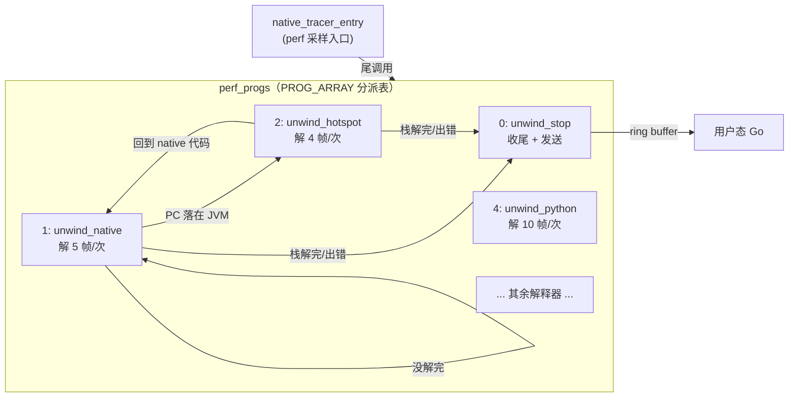

# 05 尾调用：小程序拼出大回溯器

> 系列教程：《OpenTelemetry eBPF Profiler 源码教学系列》第 05 篇
> 上一篇：[04 Stack Delta：没有帧指针也能回溯的秘密](./04-Stack-Delta.md)

## 本篇目标

读到这一篇时，你已经知道了 eBPF 程序如何做栈回溯。但一个自然的问题随之而来：**一个真实的调用栈动辄几十上百层，为什么还要把它切成一段一段，用很多个"小程序"接力完成？**

本篇的目标：

- 回顾 verifier（验证器）给单个 eBPF 程序立下的"尺寸墙"，理解为什么"一个大程序解完整个栈"这条路走不通；
- 看懂每个 unwinder（栈回溯器）程序一次只解固定几帧的设计（`NATIVE_FRAMES_PER_PROGRAM` 等常量），以及这些数字是怎么被"指令预算"逼出来的；
- 掌握尾调用（tail call）机制：`PROG_ARRAY` 分派表、`TracePrograms` 枚举、`tail_call()` 包装函数里的 29 次自限；
- 理解 `PerCPURecord` 如何扮演"续体"角色，让状态在程序之间传递；
- 看懂 `unwindersDone` 位图如何防止 native 与 interpreter（解释器）回溯器之间"打乒乓球"式的死循环；
- 了解 `MULTI_USE_FUNC` 为什么把每个程序编译两份，以及 `per_cpu_records_kp` 的隔离用意。

读完本篇，你将能用"接力赛 + 燃料表 + 交接棒"的心智模型，完整描述一条 trace（调用栈）从采样到上报在内核里走过的路径。

## 前置知识（名词解释集中区）

> **名词解释：verifier（验证器）**
> 内核在加载 eBPF 程序时执行的静态安全检查器。它会模拟执行程序的每一条可能路径，确认程序不会死循环、不会越界访问内存、指令总数不超预算。验证不通过，程序直接被拒绝加载。可以把它想象成机场安检：不管你多着急，行李（代码）超重就得上不了飞机。

> **名词解释：tail call（尾调用）**
> eBPF 提供的一种特殊跳转：当前程序调用 `bpf_tail_call()` 跳到**另一个 eBPF 程序**继续执行，而且**永远不返回**。普通函数调用会压栈、之后还要回来；尾调用则是"跳过去就不回头"，像接力赛里把棒交出去就退场。内核规定一条执行链上最多连续 32 次尾调用。

> **名词解释：PROG_ARRAY**
> 一种特殊的 eBPF map（`BPF_MAP_TYPE_PROG_ARRAY`），key 是整数索引，value 是 eBPF 程序的文件描述符。它是尾调用的"电话号码簿"：`bpf_tail_call(ctx, &prog_array, 索引)` 表示"跳到号码簿里第『索引』号的程序去"。

> **名词解释：per-CPU map**
> 每个 CPU 核心各自持有一份独立数据的 eBPF map（如 `BPF_MAP_TYPE_PERCPU_ARRAY`）。eBPF 程序运行时不会被抢占（不会被切走换别的程序在同一个 CPU 上跑），所以用 per-CPU map 存临时状态天然无锁、无竞争。类比：每个工位（CPU）配一个私人储物柜，谁在自己的工位干活就用谁的柜子，不用抢。

> **名词解释：续体（continuation）**
> 编程语言里的概念："计算进行到哪一步了"的完整快照，包括当前变量值和"接下来该干什么"。尾调用不返回、调用方栈帧也没了，所以"接下来干什么、手上的活干到哪了"必须显式存下来交给下一棒——这个项目里扮演续体角色的就是 `PerCPURecord`。

> **名词解释：kprobe / perf event**
> 两种触发 eBPF 程序的机制。perf event 是周期性采样中断（本篇主角，profiler 靠它定时"偷拍"每个 CPU 上正在运行的线程）；kprobe 是挂钩在内核函数上的探针（本项目还用它做 uprobe 相关逻辑）。两者运行在同一批 CPU 上，可能互相打断——这一点在文末的"双份程序"一节很关键。

## 为什么一个程序解不完一条栈

### 尺寸墙：指令预算与循环限制

假设你来写这个 profiler 的第一个版本，最自然的想法是：

```c
// 伪代码：理想中的一次性回溯（在 eBPF 里行不通）
while (还有下一帧) {
    unwind_one_frame();   // 解出一帧
    push_frame();         // 记录这一帧
}
```

这个循环在老内核上**根本无法通过 verifier**：早期的 eBPF 不允许循环（害怕死循环拖死内核），后来的内核允许有界循环，但 verifier 必须**展开模拟所有循环体**，于是循环内的指令会被重复计入程序的"复杂度预算"。同时，单个程序还有指令数上限（老内核 4096 条，5.2+ 放宽到 100 万条，但那是"所有路径总和"的概念，verifier 分析时间会随分支爆炸）。

而回溯一个 native 帧并不便宜——回忆第 04 篇，光解一帧就要：查 stack delta 页信息、做一次二分查找、读 unwind 指令、算 CFA（Canonical Frame Address，规范帧地址，即"调用方栈帧的栈顶位置"）、读返回地址。这还没算上 Java、Python、Ruby、V8、.NET、Perl、PHP、BEAM 等一堆解释器各自的回溯逻辑——每一种都是几百行 C 代码。

结论很直白：**把所有回溯逻辑塞进一个程序，就像想把整支交响乐团塞进一部电梯**。装不下，就得拆。

### 每个程序只解"固定一小段"

项目的解法：每个 unwinder 程序运行一次，**最多只解固定数量的帧**，然后通过尾调用把接力棒交给下一个程序（可能就是它自己）。这些数字都是各自的常量：

- native（机器码）：`support/ebpf/native_stack_trace.h:14`

  ```c
  // The number of native frames to unwind per frame-unwinding eBPF program.
  #define NATIVE_FRAMES_PER_PROGRAM 5
  ```

- HotSpot（JVM）：`support/ebpf/hotspot_tracer.ebpf.c:72`

  ```c
  // The number of hotspot frames to unwind per frame-unwinding eBPF program.
  #define HOTSPOT_FRAMES_PER_PROGRAM 4
  ```

- Python：`support/ebpf/python_tracer.ebpf.c:14`，注意它不是编译期常量，而是加载时可改的值：

  ```c
  // ... 10 fits the
  // 5.x / 6.0-6.5 verifier; the host agent bumps it to 15 on 6.6+.
  BPF_RODATA_VAR(u32, python_frames_per_program, 10)
  ```

- 其余几家也是同一套路：Perl 12（`support/ebpf/perl_tracer.ebpf.c:37`）、V8 8（`support/ebpf/v8_tracer.ebpf.c:17`）、BEAM 8、Dotnet 6。

**这些数字为什么是 4、5、8、10、12，而不是整齐划一的 10？** 因为它们全是"指令预算调出来的"：每个解释器解一帧的成本不同（HotSpot 一帧要读 512 字节的 CodeBlob 还要做启发式搜索，最贵，所以只有 4；Perl 一帧便宜，能放 12）。开发者的做法是：把数字调大，编译，加载，看 verifier 报不报错；报"程序太复杂"就调小。Python 那行注释把这个过程说得最明白——10 是"5.x 到 6.5 内核的 verifier 能接受"的值，6.6+ 内核的 verifier 更聪明，于是 host agent（用户态 Go 程序）在加载时把它提到 15。

用燃料来类比：**每个程序是一级火箭，油箱大小 = verifier 给的指令预算；每解一帧烧一格油；`FRAMES_PER_PROGRAM` 就是这级火箭在预算内最多能烧几格。** 油烧完了不硬撑，直接分离、点火下一级（尾调用）。

### 看看 native 程序的"主循环"长什么样

`support/ebpf/native_stack_trace.ebpf.c:144-199` 的 `unwind_native` 就是这个模式的标准模板。核心骨架（行号对应原文件）：

```c
static EBPF_INLINE int unwind_native(struct pt_regs *ctx)
{
  PerCPURecord *record = get_per_cpu_record();        // :146 取出"续体"
  ...
  for (u64 i = 0; i < NATIVE_FRAMES_PER_PROGRAM; i++) {  // :153 最多 5 帧
    unwinder = PROG_UNWIND_STOP;
    ...
    error = push_native(&record->state, trace, ...);  // :166 先记录当前帧
    if (error) { break; }
    error = unwind_one_frame(record, &stop, NULL);    // :180 再解出下一帧位置
    if (error || stop) { break; }
    error = get_next_unwinder_after_native_frame(record, &unwinder);  // :187
    if (error || unwinder != PROG_UNWIND_NATIVE) { break; }           // 下一个不归我管
  }
  record->state.unwind_error = error;                 // :195 把结果写回续体
  tail_call(ctx, unwinder);                           // :196 交棒！
  return -1;
}
```

注意三个细节：

1. 循环上限就是 `NATIVE_FRAMES_PER_PROGRAM`，到点就 `break`；
2. 每解完一帧都要问一句"下一帧归谁管"（`get_next_unwinder_after_native_frame`）——如果下一帧落在 JVM 解释器代码里，答案就不再是 `PROG_UNWIND_NATIVE`；
3. 函数结尾**永远**是 `tail_call(ctx, unwinder)`：栈解完了交棒给 `PROG_UNWIND_STOP`（负责收尾上报），没解完交棒给自己或某个解释器回溯器。第 197 行的 `DEBUG_PRINT("bpf_tail call failed ...")` 和第 198 行的 `return -1` 是"理论上到不了"的兜底——尾调用成功就不会返回。

## 分派表：TracePrograms 与 PROG_ARRAY

### 一张"电话号码簿"

尾调用需要回答"下一个程序的编号是多少"。这个编号体系定义在 `support/ebpf/types.h:396-411`：

```c
// TracePrograms provide the offset for each eBPF trace program in the
// map that holds them.
// The values of this enum must fit in a single byte.
typedef enum TracePrograms {
  PROG_UNWIND_STOP,      // 0: 收尾程序，发送 trace
  PROG_UNWIND_NATIVE,    // 1: 机器码回溯
  PROG_UNWIND_HOTSPOT,   // 2: JVM
  PROG_UNWIND_PERL,      // 3
  PROG_UNWIND_PYTHON,    // 4
  PROG_UNWIND_PHP,       // 5
  PROG_UNWIND_RUBY,      // 6
  PROG_UNWIND_V8,        // 7
  PROG_UNWIND_DOTNET,    // 8
  PROG_UNWIND_DOTNET10,  // 9
  PROG_GO_LABELS,        // 10: Go 自定义标签提取
  PROG_UNWIND_BEAM,      // 11: Erlang/Elixir
  PROG_UNWIND_LUAJIT,    // 12
  NUM_TRACER_PROGS,      // 13: 总数
} TracePrograms;
```

配套的"号码簿" map 定义在 `support/ebpf/interpreter_dispatcher.ebpf.c:41-47`：

```c
// perf_progs maps from a program ID to a perf eBPF program
struct perf_progs_t {
  __uint(type, BPF_MAP_TYPE_PROG_ARRAY);
  __type(key, u32);
  __type(value, u32);
  __uint(max_entries, NUM_TRACER_PROGS);
} perf_progs SEC(".maps");
```

`BPF_MAP_TYPE_PROG_ARRAY` 的 value 存的是**已加载程序的文件描述符**。谁往里填号码？用户态 Go 代码。`tracer/tracer.go:519-522` 先登记两个必备节目：

```go
tailCallProgs := []ProgLoaderHelper{
    {ProgID: uint32(support.ProgUnwindStop), Name: "unwind_stop", Enable: true},
    {ProgID: uint32(support.ProgUnwindNative), Name: "unwind_native", Enable: true},
}
```

随后遍历各解释器的 loader 把它们的程序追加进来（`tracer/tracer.go:523-533`）。每个程序加载成功后，在 `loadProgram`（`tracer/tracer.go:930-972`）里执行关键一步（:963-970）：把程序的文件描述符按 `ProgID` 写进 `perf_progs` 分派表：

```go
fd := uint32(unwinder.FD())
if err := tailcallMap.Update(unsafe.Pointer(&progID), unsafe.Pointer(&fd),
    cebpf.UpdateAny); err != nil {
```

至此，C 侧的枚举值和 Go 侧填的表项严丝合缝地对上了：**C 代码里的 `PROG_UNWIND_PYTHON`（=4）既是枚举值，也是分派表索引，还是 Go 侧写表时用的 key。** 三方一致，整个分派机制才转得起来。



### 谁来决定"下一个节目"

分派决策链在 `support/ebpf/tracemgmt.h` 里。native 帧解完后调用 `get_next_unwinder_after_native_frame`（:972-995）：先 `resolve_unwind_mapping`（:843-894）拿当前 PC 去查 `pid_page_to_mapping_info` 这张 LPM trie map（LPM = Longest Prefix Match，最长前缀匹配，用"进程 ID + 地址页"做 key，查出这个地址属于哪个可执行文件、该用哪个回溯器），如果答案是 native，再进 `get_next_interpreter`（:950-968）做二次判断：

```c
static inline EBPF_INLINE int get_next_interpreter(PerCPURecord *record)
{
  ...
  OffsetRange *range = bpf_map_lookup_elem(&interpreter_offsets, &section_id);
  if (range != 0) {
    if (matches_interpreter_range(section_offset, range)) {
      DEBUG_PRINT("interpreter_offsets match %d", range->program_index);
      if (!unwinder_is_done(record, range->program_index)) {   // :960 防振荡！
        increment_metric(metricID_UnwindCallInterpreter);
        return range->program_index;
      }
      ...
```

`interpreter_offsets` 里登记的是"哪个可执行文件的哪段地址区间是解释器主循环"，`OffsetRange.program_index`（`support/ebpf/types.h:1101`）就是命中后要跳去的分派表索引。:960 那行的 `unwinder_is_done` 检查先记住，后文"防振荡"一节细讲。

## tail_call 包装函数：燃料表与 3 格保命余量

### 内核只给 32 次机会

一条尾调用链（从 perf 采样入口开始算起）在内核里最多连续跳 **32 次**。假设栈很深，native 程序每次解 5 帧就尾调用自己一次，那么 32 次也就够解一百多帧——更重要的是：**如果连一次尾调用额度都不剩，就没法跳到 `unwind_stop` 把已经解出来的栈送出去了**，等于白干。

所以项目没有直接裸调 `bpf_tail_call()`，而是包了一层带"油量表"的包装函数，`support/ebpf/tracemgmt.h:1008-1031`：

```c
// tail_call is a wrapper around bpf_tail_call() and ensures that the number of tail calls is not
// reached while unwinding the stack.
static inline EBPF_INLINE void tail_call(void *ctx, int next)
{
  PerCPURecord *record = get_per_cpu_record();
  if (!record) {
    bpf_tail_call(ctx, &perf_progs, PROG_UNWIND_STOP);
    // In theory bpf_tail_call() should never return. ...
    return;
  }

  if (record->tailCalls >= 29) {
    // The maximum tail call count we need to support on older kernels is 32. ...
    // As a result we might lose the unwound stack as no further tail calls are left
    // to report it to user space. To make sure we do not run into this issue we stop unwinding
    // the stack at this point and report it to userspace.
    next                       = PROG_UNWIND_STOP;
    record->state.unwind_error = ERR_MAX_TAIL_CALLS;
    increment_metric(metricID_MaxTailCalls);
  }
  record->tailCalls += 1;

  bpf_tail_call(ctx, &perf_progs, next);
}
```

逐块解读：

- **:1010-1016**：拿不到续体（理论上不该发生）时，保命优先——直接裸跳到 `PROG_UNWIND_STOP`，有多少算多少先送出去。注释里那句"bribe the verifier"（贿赂验证器）是个有趣的工程细节：编译器可能重排指令，所以即使 `bpf_tail_call` 永不返回，也得写个 `return` 让 verifier 满意。
- **:1018-1027**：核心策略。**自限 29 次**，而不是用到 32 次撞墙。为什么留 3 次余量？因为交棒给 `unwind_stop` 本身要 1 次；`unwind_stop` 里如果这是 Go 进程，还可能再尾调用 `PROG_GO_LABELS` 去提取 Go 自定义标签（`support/ebpf/interpreter_dispatcher.ebpf.c:185-187` 的注释明说了"Go 标签提取代码太大，塞不进 UNWIND_STOP 程序，所以走尾调用"）。留足余量，才能保证**任何情况下都一定有燃料把 trace 送到用户态**。
- **:1024-1026**：到达上限时不算崩溃，而是"优雅降级"——把目的地强行改成 STOP，记一个 `ERR_MAX_TAIL_CALLS` 错误码和 `metricID_MaxTailCalls` 指标（`support/ebpf/types.h:220-221`），用户态看到的是一条截断但完整的栈，外加一个"被尾调用上限截断"的标记。

这就是"燃料表"设计：**每次交棒前 `record->tailCalls += 1`（:1028）记一笔账，油表指到 29 就强制进站。** 宁可少解几帧，绝不冒"解完了却送不出去"的险。

## PerCPURecord：跨程序续体

### 没有它，尾调用就是失忆

尾调用不保留任何调用现场：没有参数、没有返回值、没有调用栈。程序 A 跳到程序 B，B 一睁眼就要回答一连串问题：当前解到哪个 PC 了？SP/FP 是多少？trace 里已经压了几帧？燃料还剩几格？Python 那边解到哪个 PyFrameObject 了？

所有答案都在 `PerCPURecord` 里，`support/ebpf/types.h:922-977`（节选）：

```c
// Per-CPU info for the stack being built. This contains the stack as well as
// meta-data on the number of eBPF tail-calls used so far to construct it.
typedef struct PerCPURecord {
  // The output record, including the stack being built.
  Trace trace;
  // The current unwind state.
  UnwindState state;
  // The current Perl unwinder state
  PerlUnwindState perlUnwindState;
  // The current Python unwinder state.
  PythonUnwindState pythonUnwindState;
  ...
  union {
    // Scratch space for the HotSpot unwinder.
    HotspotUnwindScratchSpace hotspotUnwindScratch;
    // Scratch space for the Python unwinder
    PythonUnwindScratchSpace pythonUnwindScratch;
    ...
  };
  // Mask to indicate which unwinders are complete
  u32 unwindersDone;

  // tailCalls tracks the number of calls to bpf_tail_call().
  u8 tailCalls;
  ...
} PerCPURecord;
```

它装在一张每个 CPU 一个槽位的 per-CPU map 里（`support/ebpf/interpreter_dispatcher.ebpf.c:15-20` 的 `per_cpu_records`，`BPF_MAP_TYPE_PERCPU_ARRAY`，`max_entries = 1`），通过 `get_per_cpu_record()`（`support/ebpf/tracemgmt.h:488-492`）用固定 key 0 取出。

这个结构体就是一台**状态机**的全部状态：

- `trace`：正在搭建的成品——已压入的帧都记在这里；
- `state`（`UnwindState`）：当前 PC/SP/FP 等寄存器快照，native 回溯器的"光标"；
- 各解释器的 `xxxUnwindState`：各自的"书签"。比如 Python 的（`support/ebpf/types.h:801-804`）只存一个 `py_frame` 指针——"下次轮到我时，从这个 PyFrameObject 继续"。Python 程序每次跑完都把游标存回去（`support/ebpf/python_tracer.ebpf.c:391-392` 的 `save_python_cursor` 标签），下一棒醒来按书签接着翻页；
- `unwindersDone` 与 `tailCalls`：防振荡位图和燃料表，下面细说。

因为是 per-CPU 的，同一时刻一个 CPU 上只有一条 trace 在搭建，天然不需要锁。一条 trace 从 `collect_trace`（`support/ebpf/tracemgmt.h:1186`）开始搭建——它先用 `get_pristine_per_cpu_record()`（:498-536）把续体全部字段清零重置，包括 `unwindersDone = 0`、`tailCalls = 0`（:516-517），然后才发出第一棒。

### 32KB 静态断言与 scratch union：省出来的每一字节

`PerCPURecord` 很大（光 `trace` 里就有约 24KB 的帧数据缓冲区），所以它有个硬上限，紧跟着结构体定义（`support/ebpf/types.h:977`）：

```c
_Static_assert(sizeof(struct PerCPURecord) <= (32 << 10), "Per CPU record too large");
```

32KB 对应内核 per-CPU 动态分配的规格上限（注释里给了内核 `percpu.h` 的链接）。`_Static_assert` 是编译期断言——结构体哪天超了 32KB，编译直接失败，把问题挡在开发阶段。

更有味道的是那个匿名 `union`（`support/ebpf/types.h:940-962`）。它把各家解释器的"草稿纸"（scratch space）叠放共享同一块内存：HotSpot 要 512 字节读 CodeBlob、Python 要 320 字节读帧对象和代码对象、native 要一个数组读信号帧寄存器……这些草稿**只在某个 unwinder 运行时临时使用，跨程序不需要保留**，所以共用一块内存就行，总面积取最大值而非总和。

为什么不能把这些草稿放函数局部变量里？因为 **eBPF 程序的栈只有 512 字节**——这是内核给每个 eBPF 程序的硬性栈空间上限，比纸还薄。`support/ebpf/native_stack_trace.h:273-274` 处理信号帧时的注释把动机写得很直白：

```c
// Use the PerCPURecord scratch union instead of a stack-local buffer to avoid
// exceeding the 512-byte BPF stack limit when inlined into interpreters.
u64 *rt_regs = record->rt_regs;
```

x86_64 上信号帧要读 18 个寄存器（144 字节），aarch64 上要 34 个（272 字节，见 `support/ebpf/types.h:955` 的注释）——放局部变量，再叠上其它局部量，512 字节很容易爆。放 union 里，一个字节的栈都不占。这是 eBPF 编程的典型生存智慧：**栈是用来走流程的，大块内存一律去 map 里借。**

## unwindersDone 位图：防止"打乒乓球"

混合栈里有个真实的死循环风险。想象一条 Java 栈：native 帧 → JVM 解释器帧 → native 帧 → JVM 帧……native 程序解到 JVM 地址区间，交棒给 HotSpot 程序；HotSpot 解完自己认识的帧，交棒回 native；native 一看 PC 又落在 JVM 区间，再交棒给 HotSpot……如果 HotSpot 已经无帧可解（比如它的帧已经全部解完，但 native 侧每次都会"礼貌地"再请它出山），两个程序就会**互相交棒直到把 32 次尾调用额度烧光**，白白浪费燃料还解不出新东西。

解法就是 `PerCPURecord` 里的 `unwindersDone` 位图（bitmap，用一个整数的每个 bit 代表"某 unwinder 是否已经完工"），配套两个操作函数在 `support/ebpf/tracemgmt.h:540-551`：

```c
// unwinder_is_done checks if a given unwinder program is done for the trace
// extraction round.
static inline EBPF_INLINE bool unwinder_is_done(const PerCPURecord *record, int unwinder)
{
  return (record->unwindersDone & (1U << unwinder)) != 0;
}

// unwinder_mark_done will mask out a given unwinder program so that it will
// not be called again for the same trace. ...
static inline EBPF_INLINE void unwinder_mark_done(PerCPURecord *record, int unwinder)
{
  record->unwindersDone |= 1U << unwinder;
}
```

规则很简单：**每个解释器回溯器在确认"属于我的帧都解完了"时，给自己的 bit 盖个"已完工"章**。以 Python 为例（`support/ebpf/python_tracer.ebpf.c:279` 和 :284）：解帧出错或者 `py_frame` 指针走到头时，都会 `unwinder_mark_done(record, PROG_UNWIND_PYTHON)`。

而 native 侧每次想交棒给解释器之前，先查章——就是前面 `get_next_interpreter` 里 :960 行那个 `if (!unwinder_is_done(record, range->program_index))`。盖过章的，直接跳过，改投 `PROG_UNWIND_NATIVE`（:967）。

用接力赛的话说：**每个选手下场时在记录板上签名，裁判（分派逻辑）看到签名就知道这棒不用再传给他了。** 位图每 bit 对应枚举里的一个程序，索引正好是 `TracePrograms` 的值——枚举"值必须放进一个字节"的注释（`support/ebpf/types.h:395`）在这里也呼应上了。

## MULTI_USE_FUNC：一套代码，两份程序，两套储物柜

### 为什么编译两份

打开任何一个解释器回溯器文件的末尾，都会看到一行魔术般的宏调用，比如 `support/ebpf/native_stack_trace.ebpf.c:220`：

```c
MULTI_USE_FUNC(unwind_native)
```

这个宏定义在 `support/ebpf/tracemgmt.h:20-31`：

```c
// MULTI_USE_FUNC generates perf event and kprobe eBPF programs
// for a given function.
#define MULTI_USE_FUNC(func_name)                                                                \
  SEC("perf_event/" #func_name)                                                                  \
  static int EBPF_INLINE perf_##func_name(struct pt_regs *ctx)                                   \
  {                                                                                              \
    return func_name(ctx);                                                                       \
  }                                                                                              \
                                                                                                 \
  SEC("kprobe/" #func_name)                                                                      \
  static int EBPF_INLINE kprobe_##func_name(struct pt_regs *ctx)                                 \
  {                                                                                              \
    return func_name(ctx);                                                                       \
  }
```

宏展开后，同一个 `unwind_native` 函数体被编译成**两个独立的 eBPF 程序**：`perf_event/unwind_native`（给周期采样用）和 `kprobe/unwind_native`（给 kprobe/uprobe 类探针用）。Go 侧加载时按前缀挑程序：perf 系加载 `"perf_" + 名字`（`tracer/tracer.go:836-838`），probe 系加载 `"kprobe_" + 名字`（`tracer/tracer.go:892-894`），各配各的分派表（`perf_progs` 与 `kprobe_progs`）。

### 两份程序为什么要两个续体储物柜

问题来了：两种程序共享 `get_per_cpu_record()`，而它是 per-CPU 的——**同一个 CPU 上，perf 采样中断可能打断一个正在执行 kprobe 回溯的程序**（kprobe 路径不受 `bpf_prog_active` 防重入保护）。如果两者共用同一个 `per_cpu_records` 槽位，采样程序一进来 `get_pristine_per_cpu_record()` 就把 kprobe 那边搭了一半的 trace 清零了——等中断返回，kprobe 程序接着往下跑，面对的是被洗劫一空的储物柜。

修复方案在 `support/ebpf/interpreter_dispatcher.ebpf.c:22-31`：再开一张一模一样的 map，专门给 probe 系用：

```c
// per_cpu_records_kp is a second per-CPU record used by the probe unwinder.
// At load time loadProbeUnwinders repoints its get_per_cpu_record() from
// per_cpu_records to this map, so a perf sampler interrupting an in-flight uprobe
// unwind (uprobes are not covered by bpf_prog_active) cannot clobber its record.
struct per_cpu_records_kp_t {
  __uint(type, BPF_MAP_TYPE_PERCPU_ARRAY);
  __type(key, int);
  __type(value, PerCPURecord);
  __uint(max_entries, 1);
} per_cpu_records_kp SEC(".maps");
```

注意这个 C 文件里并没有程序真正去查这张表——它靠 `support/ebpf/off_cpu.ebpf.c:61-69` 里一个"永不加载的假程序"引用它，保证 map 会被创建。真正的换柜动作发生在**加载时的指令重写**，`tracer/tracer.go:911-917`：

```go
// Repoint per_cpu_records to the probe unwinder's own record map.
recInsns := progArrayReferences(perCPURecordsFD, progSpec.Instructions)
for _, ins := range recInsns {
    if err := progSpec.Instructions[ins].AssociateMap(perCPURecordsKprobeMap); err != nil {
        return fmt.Errorf("failed to rewrite per_cpu_records ptr: %v", err)
    }
}
```

这段 Go 代码做的事相当硬核：在把 kprobe 版程序喂给内核之前，**逐条扫描它的指令流**，找出所有"引用 `per_cpu_records` 这张 map"的 load 指令，把它们就地改成指向 `per_cpu_records_kp`。`tracer/tracer.go:541-543` 的注释一句话总结动机："a perf sampler can't clobber an in-flight uprobe unwind"（perf 采样器再也不能踩坏进行中的 uprobe 回溯）。C 代码一套，运行期两柜，互不干扰——这是很典型的"二进制级别的依赖注入"。

## 全景复盘：一条 trace 的接力全程

把本篇所有零件装回整机，一条 trace 的完整接力如下（`collect_trace` 起步，`support/ebpf/tracemgmt.h:1186-1264`）：

```
perf 中断（每 CPU 每秒 N 次）
  │
  ▼
native_tracer_entry ──► collect_trace
  │                     ├─ get_pristine_per_cpu_record()  清空储物柜（tailCalls=0, unwindersDone=0）
  │                     ├─ push_kernel_frames()           先存内核栈
  │                     ├─ get_usermode_regs()            取用户态 PC/SP/FP 存入续体
  │                     └─ tail_call(ctx, unwinder)  ────┐ 第一棒（tailCalls=1）
  ▼                                                    ▼
            ┌───────────── perf_progs 分派表 ─────────────┐
            │  unwind_native：解 ≤5 帧，烧 1 格燃料/棒      │
            │     │ 下一帧在 JVM？──► unwind_hotspot(≤4帧) │
            │     │ 下一帧在 Python？► unwind_python(≤10帧)│
            │     ▼ （盖完工章的解释器直接跳过）             │
            │  循环接力，直到：栈解完 / 出错 / 燃料≥29        │
            └──────────────────┬─────────────────────────┘
                               ▼
                  unwind_stop（PROG_UNWIND_STOP）
                    ├─ 补 APM trace ID / Go 标签（可能再尾调用一次）
                    ├─ 若有错误码，压入错误帧
                    └─ send_trace() ──► trace_events ring buffer ──► 用户态 Go
```

`send_trace`（`support/ebpf/tracemgmt.h:748-766`）通过 ring buffer（环形缓冲区，内核与用户态共享的一块队列内存）把 trace 推出去，整个接力结束。下一场采样中断到来时，储物柜再次被清空，新的接力开始——前后两场互不影响。

## 动手实验

以下实验都不需要你真的有 Linux 环境来跑 profiler，重在"用代码验证理解"：

1. **数清分派表**。在仓库里执行（或用编辑器搜索）：`grep -rn "PROG_UNWIND_" support/ebpf/types.h`，对照 `TracePrograms` 枚举（`support/ebpf/types.h:396-411`）数出 13 个节目；再到 `tracer/tracer.go:519-533` 确认 Go 侧登记分派表的代码。思考：如果新增一个解释器，C 枚举、Go 常量（`support/types_def.go`）、`perf_progs` 的 `max_entries` 三处分别要动什么？

2. **追一次完整的交棒链**。从 `support/ebpf/tracemgmt.h:1261`（`collect_trace` 发出的第一棒）出发，用笔和纸画出一条"Java 进程、60 层混合栈"的假想接力路线：哪些棒交给 `unwind_native`、哪些交给 `unwind_hotspot`、`tailCalls` 计数值如何变化、第 29 次交棒时会发生什么（提示：`ERR_MAX_TAIL_CALLS`）。

3. **找全所有尾调用点**。搜索 `tail_call(ctx,` 在 `support/ebpf/` 下的所有出现位置，列出每个调用点的"交棒条件"（解完了？出错了？换语言了？）。你会发现几乎所有 unwinder 的出口都长一个样——这是刻意的架构统一。

4. **验证 512 字节栈的说法**。阅读 `support/ebpf/types.h:840-845`（HotSpot 的 512 字节 codeblob 缓冲区）和 `support/ebpf/native_stack_trace.h:272-296`（信号帧处理），数一数如果 `rt_regs` 改成局部变量，x86_64 和 aarch64 分别要占多少栈字节。再想想：为什么 union 里各家 scratch 不需要清零复用？

5. **（进阶，需 Linux 机器）看 verifier 日志**。如果有 Linux 环境，给 agent 配置 `BPFVerifierLogLevel`（`tracer/tracer.go:266-267`，`loadProgram` 会把 verifier 日志逐行打出来），试着把 `NATIVE_FRAMES_PER_PROGRAM` 从 5 改成 20 重新编译加载（注意：这只是学习实验，别提交），观察 verifier 如何拒绝过大的程序——亲身体验"指令预算"的存在。

## 小结

本篇我们解决了"一个程序装不下整套回溯逻辑"的工程难题，项目给出的答案是一套精巧的多程序协作机制：

- **尺寸墙是真实的**：verifier 的指令预算决定了单个程序只能解固定几帧——native 5、HotSpot 4、Python 10、Perl 12，这些数字全是"调到 verifier 能接受为止"的产物；
- **尾调用 + PROG_ARRAY 分派表**是接力的传送带：`TracePrograms` 枚举统一编号，Go 侧加载时把程序描述符填进表里；
- **`tail_call()` 包装函数**自带燃料表：自限 29 次、留 3 次余量，保证任何情况下都跳得到 `unwind_stop` 把成果送出去；
- **`PerCPURecord`** 是跨程序续体：trace 半成品、寄存器状态、各解释器书签、燃料计数、完工位图全在里面；32KB 静态断言守住体积，scratch union 绕开 512 字节栈限制；
- **`unwindersDone` 位图**给完工的 unwinder 盖章，杜绝 native 与解释器之间空转振荡；
- **`MULTI_USE_FUNC` + `per_cpu_records_kp`** 用"一套源码两份程序两个储物柜"解决了 perf 与 kprobe 在同一 CPU 上互相踩状态的问题。

记住那个总比喻：**这是一场接力赛。每个程序是一级油箱有限的火箭，`PerCPURecord` 是随棒传递的航行日志，`tailCalls` 是燃料表，`unwindersDone` 是选手签名板，而 `unwind_stop` 是无论发生什么都要抵达的终点线。**

## 下一篇预告

[06 混合栈穿透：一条 trace 穿越内核、libc 与 JVM](./06-混合栈穿透.md)

本篇我们多次提到"下一帧归谁管"——native 程序靠 `interpreter_offsets` 判断 PC 是否落在解释器主循环里，靠 `pid_page_to_mapping_info` 判断地址属于哪个文件。下一篇我们把这些判断串起来，跟着一条真实的混合栈走一遍：从内核帧出发，穿过 libc 的 native 帧，进入 JVM 的 JIT 代码与解释器帧，看三种世界的帧如何在同一条 trace 里无缝拼接，以及每种边界的 PC 语义（返回地址要减 1、ARM64 的 LR 信任规则）有何讲究。
